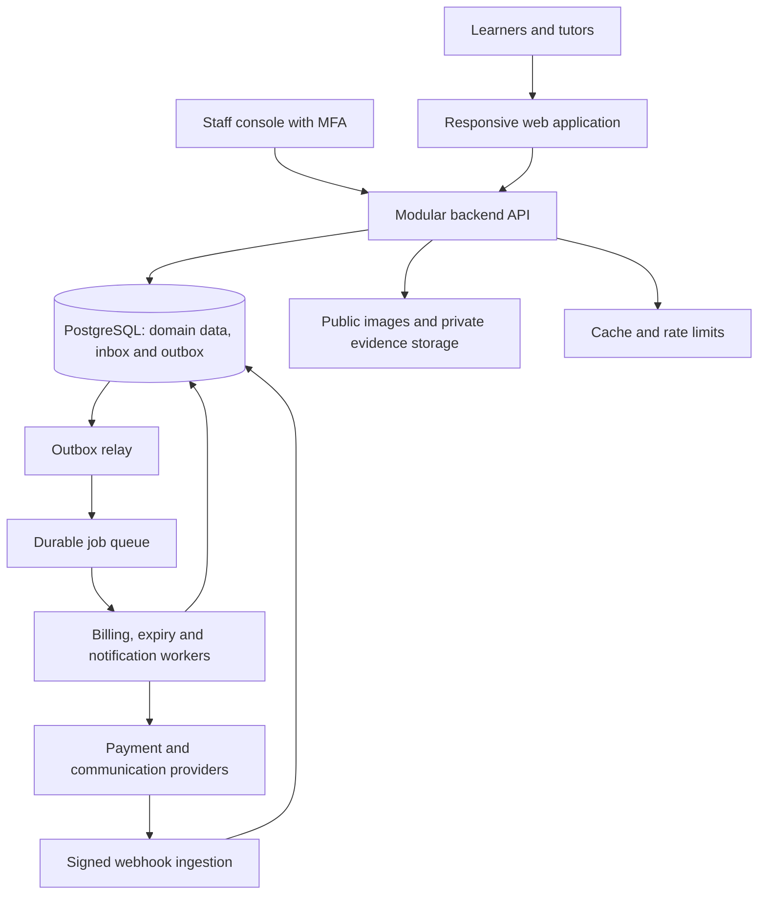

# Build plan: tutoring marketplace similar to Superprof

Prepared: 10 October 2026

Production interview update: accepted decisions in `docs/adr/` take precedence over this plan's assumptions. The first launch is online tutoring across India with a broad learning catalogue including JEE and NEET; the narrow subject/CBSE pilot is superseded, and local in-person discovery is deferred. Paid contact scope and guardian-controlled child access are confirmed; current commercial and operating decisions are recorded in `.scratch/production/map.md`.

Source: [Superprof India business, HLD and LLD blueprint](./Superprof_India_Business_HLD_LLD_Blueprint.md).

Implementation source of truth: [production specification](./.scratch/production/spec.md) and [28-ticket implementation index](./.scratch/production/README.md). Use their confirmed scope, policies and release gates in place of superseded illustrative assumptions below.

UI update, 11 October 2026: the owner selected Lovable for the final interface. [ADR-0009](./docs/adr/0009-lovable-ui-and-authoritative-api.md) supersedes the final Next.js UI assumption below. NestJS/PostgreSQL remain authoritative; ticket 01's Next.js screens are a local integration harness. [Lovable prompt](./docs/lovable/task-01-prompt.md).

Build an India-focused marketplace where learners discover tutors, buy time-limited contact access, receive tutor acceptance, and communicate through a private connection. Tutors create free listings; teaching fees are settled directly between learner and tutor. The first release delivers this complete business loop with billing, support and trust operations.

This plan translates the source blueprint into implementation work. Scope choices, timelines, pilot targets and policies below are proposals. The blueprint's competitor prices are historical research references, not confirmed prices for our product. Use original branding, copy and interface design.

## 1. Proposed launch scope and decisions

| Decision | Planning assumption | Action before implementation depends on it |
|---|---|---|
| Market | India, INR, English interface, online tutoring plus one city | Product owner selects city and initial subject catalogue in week 1 |
| Audience | Adult learners and guardians arranging lessons for children | Approve guardian authority, child-data minimisation and contact rules before child flows ship |
| Supply | Start with 3–5 subjects and recruit 50–100 eligible tutors | Validate demand through interviews; track coverage by subject, level, language and locality |
| Product | Responsive web application for learners, tutors and staff | Native mobile applications enter the later roadmap |
| Revenue | Student access pass; tutor Pro after pilot | Decide price from interviews and unit economics; configure immutable plan versions |
| Access term | 30 days from first qualifying tutor acceptance after confirmed payment | Publish exact activation, expiry and no-match rules |
| First checkout | Hosted immediate payment; captured funds wait for matching | Confirm available payment methods and refund behaviour with selected provider |
| Renewal | Manual repurchase in MVP | Recurring renewal is a separate release with mandate, consent, cancellation and reconciliation work |
| Request deadline | Proposed 72-hour response window | Store deadline on submission; configure reminders independently |
| No-match deadline | Proposed 72 hours from confirmed first payment | Expire pending purchase requests and initiate refund if no eligible match; disclose provider refund timing separately |
| Tuition | Direct settlement with tutor | Explain platform fee and lesson price separately throughout checkout and support |
| Verification | Staff review of declared evidence with check-specific labels | Define checks, reviewer access and retention policy |

These assumptions allow planning to proceed. Product, finance and privacy owners must resolve relevant decisions before their screens and workflows are finalised. A new request close to the purchase no-match deadline expires at the earlier of its own deadline and the purchase deadline. Requests covered by an already active pass retain their submission entitlement until their recorded expiry, subject to revocation and safety restrictions.

## 2. MVP feature inventory

| Area | First release | Source requirements |
|---|---|---|
| Identity | Registration, verified email/phone flow, login, reset, session revocation, student/tutor roles | FR-01–02 |
| Guardians | Account-owned learner profiles, guardian authority and consent, private child information | FR-03 |
| Tutor onboarding | Biography, subjects, levels, languages, photo, credentials and private evidence upload | FR-04–05 |
| Listings | Rates and units, delivery mode, approximate locality/service area, trial terms, submit/review/publish/pause | FR-06–07 |
| Discovery | Subject, level, online/in-person, locality, language and budget filters; profile pages and explicit alternatives | FR-08–10 |
| Requests | Learner goals, preferred times, tutor accept/decline, cancellation, reminders, expiry and replacement selection | FR-13–15 |
| Access and billing | Versioned pass offer, checkout, payment history, activation, entitlements, refunds, receipts, chargeback handling and reconciliation | FR-16–18, FR-21–22 |
| Connections | Contact release only after tutor acceptance and financial eligibility; preserve existing connections after pass expiry | FR-18 |
| Messaging | Durable text history, realtime updates, unread status, retry deduplication and reconnect recovery | FR-25–27 |
| Reputation | Connection-linked review eligibility, moderation, honest evidence labels and published aggregates | FR-28–30; independent recommendation invitations follow in P1 |
| Staff operations | Listing and evidence review, reports, blocks, suspensions, support tickets, scoped financial tools and audit records | FR-31–34 |
| Privacy and growth | Data export/deletion, consent records, useful SEO pages, funnel and marketplace reporting | FR-35–37 |

Recurring subscriptions and cancellation controls (FR-19–20) become mandatory when recurring billing is enabled. Recommendation invitations are an explicit deferral from the blueprint's reputation scope; the MVP stores review evidence types so these can be added without relabelling reviews.

Later releases include favourites, tutor Pro, tutor analytics, recommendation invitations, promotions, scheduling, lesson payments, payouts, classroom tools, organisation accounts and ML ranking.

## 3. User journeys and screens

### Learner or guardian

1. Search by subject and teaching mode; narrow by level, language, budget and location.
2. Read tutor profile, precise verification labels, rates, reviews and trial terms.
3. Sign in, select the learner beneficiary and draft learning goals.
4. If access is absent, review the pass price, separate tuition cost, activation rule and no-match policy, then complete hosted checkout.
5. Submit requests against the same purchase cycle; see pending, declined, expired and accepted states.
6. Once acceptance and verified payment qualify, receive a connection and access private messaging/contact details.
7. Continue established conversations after pass expiry; repurchase to contact new tutors.
8. Review, report, block, request support, inspect payment history or request data export/deletion.

### Tutor

1. Create profile, upload evidence and create subject-specific listings.
2. Submit for staff review, respond to requested changes and publish approved offers.
3. Receive request notifications and accept or decline from the inbox.
4. Communicate once the connection is authorised; manage listing availability.
5. View reviews and request support or report unsafe behaviour.

### Staff

1. Review listings and scan-approved private evidence.
2. Triage unanswered requests, paid-but-unmatched purchases, support and safety reports.
3. Approve refunds within assigned limits and inspect reconciliation exceptions.
4. Restrict accounts with recorded reasons; process privacy requests and review audit history.

| Surface | Required screens |
|---|---|
| Public | Home/search, results, tutor detail, supported subject/locality pages, pricing, how it works, help and policy pages |
| Account | Sign-up/login, verification/reset, role selection, account settings and learner profiles |
| Learner | Request form, checkout, payment pending/failure, request dashboard, connection/chat, pass/payment history, reviews and support |
| Tutor | Onboarding, profile/listing editor and preview, verification status, listing dashboard, request inbox and chat |
| Staff | Restricted login with MFA, listing/evidence queues, moderation cases, support cases, billing/refunds, reconciliation and audit views |

All core screens include loading, empty, failure, pending and retry states. Review mobile layouts, keyboard navigation, labels, focus and error announcements before implementation sign-off.

## 4. Architecture and implementation structure

Use the blueprint's modular monolith: one business backend with explicit domain modules, plus independently running workers. Keep money, requests and permissions authoritative in PostgreSQL.



| Layer | Planned choice | Implementation boundary |
|---|---|---|
| Web | TypeScript, React, Next.js | Public rendered pages; authenticated learner/tutor/staff screens |
| API | TypeScript, NestJS | Identity, catalogue, trust, discovery, requests, billing, access, connections, messaging, reputation, operations and privacy modules |
| Database | Managed PostgreSQL | Transactions, foreign keys, uniqueness, indexes and migrations; add PostGIS when radius search is required |
| Files | Managed object storage | Public tutor images separated from private evidence; signed URLs and upload validation/scan |
| Jobs | Managed durable queue and worker processes | Retries, deadlines, billing reconciliation, notification delivery and dead-letter recovery |
| Cache | Redis when needed | Rate limits/cache/realtime coordination; authoritative financial state stays in database |
| Payments | Hosted India-capable provider; evaluate Razorpay | Confirm account capabilities in week 1; implement adapter and sandbox integration |
| Notifications | Email first, SMS for selected critical events | Delivery tracking, preferences and provider configuration |
| Hosting | Managed application/container service and managed database | Separate environments, secrets, private database networking and repeatable deployment |

Next.js supports page metadata and social preview configuration; use it for tutor and catalogue pages. NestJS modules provide a suitable mechanism for the planned backend boundaries. These capabilities were checked against [Next.js documentation](https://nextjs.org/docs/app/getting-started/metadata-and-og-images) and [NestJS documentation](https://docs.nestjs.com/modules). Select supported versions during setup and lock dependencies.

Proposed repository layout:

```text
apps/
  web/                  # Public site and authenticated dashboards
  api/                  # Domain modules, REST endpoints and webhook ingestion
  worker/               # Workers using the same backend domain services
packages/
  contracts/            # API/event schemas and validation contracts
  ui/                   # Shared accessible components
infra/                  # Environment and deployment definitions
docs/                   # Decisions, policies, runbooks and API documentation
```

Use the blueprint's section 8 as the schema baseline and section 14 as the API baseline. Create only MVP tables plus the inbox/outbox, audit and idempotency infrastructure; defer lesson booking, tuition payout and classroom tables. Schema work must include ownership, money in integer paise, immutable price/policy snapshots, UTC timestamps and named display time zones.

## 5. Payment and access rules to implement first

Billing and contact permissions are the highest-risk implementation path. Write these invariants before wiring checkout to the interface:

1. A payer has one stable membership per access product/market; each cycle represents one payable obligation.
2. Multiple tutor requests and concurrent acceptances share that cycle. A purchase activates one entitlement, with its start/end fixed once.
3. A browser payment-success screen cannot grant access. Verify payment identity, amount, currency and provider state on the server.
4. Tutor acceptance alone cannot expose private contacts. Current safety eligibility and qualifying financial access are checked at connection creation and contact read.
5. First-purchase requests begin only after the selected payment-readiness condition. Captured funds wait for matching; a deadline worker refunds unmatched purchases.
6. The deadline worker and activation worker lock the same membership/cycle. A purchase committed to reversal cannot later activate because of a delayed acceptance event.
7. Existing access grants authorise requests at submission; eligible pending requests can complete after pass expiry without a new charge.
8. A payment with unknown outcome blocks replacement checkout until reconciliation resolves it. Record unexpected excess captures and route them to refunds.
9. Webhooks enter a durable deduplicated inbox; financial postings, entitlements and downstream notifications use business keys and transactional outbox events.
10. External provider calls occur outside database transactions. Retriable workers fetch provider status after ambiguous failures.
11. Refund amounts include reservations for pending refunds; chargebacks and refunds are reconciled together to prevent excess recovery.
12. A block, suspension or revoked grant overrides conversation/contact access. Connection persistence after expiry never overrides a safety restriction.

Razorpay documents duplicate and out-of-order webhook delivery; design processing and reconciliation accordingly. See [Razorpay webhook best practices](https://razorpay.com/docs/webhooks/best-practices/).

## 6. Delivery roadmap: 14-week planning baseline

Assume one product/marketplace owner, one frontend engineer, two backend/full-stack engineers, shared QA/reliability capacity, an operations owner and timely vendor/policy decisions. This is an indicative plan, not a delivery commitment. Re-estimate after week 2; reserve an additional 2 weeks if integrations or acceptance gates need it. A solo build needs a separate estimate.

| Phase | Weeks | Main tasks and deliverables | Exit gate |
|---|---|---|---|
| 0. Pilot definition and dependency checks | 1 | Learner/tutor interviews; city and subjects; price/no-match decisions; payment sandbox and capability check; support/privacy ownership; recruitment begins | Pilot brief, decision register and usable vendor test credentials |
| 1. Design and engineering foundations | 2–3 | Core screen prototypes; identity and role matrix; monorepo; CI; staging; schema/migrations; contracts; secrets; object storage; outbox/inbox; observability | Verified account flow in staging, staff MFA and approved journey designs |
| 2. Supply and discovery | 4–5 | Tutor onboarding; evidence upload/scan; staff review; listing lifecycle; search filters and ranking baseline; public profile/SEO pages | Real approved tutors discoverable; private fields absent; supply gaps visible |
| 3. Requests and communication | 6–7 | Request/accept/decline/expiry; connection policy; text messaging/reconnect; email/SMS jobs; blocks/reports; support tools | Full journey works in staging using explicitly test-only access grants; unauthorised reads denied |
| 4. Paid access and finance | 8–10 | Hosted checkout; cycles/entitlements; signed webhooks; concurrency control; no-match refunds; receipts/history; chargebacks; settlement reconciliation and staff financial permissions | Failure/concurrency suite passes; money and access match provider sandbox records |
| 5. Trust and release preparation | 11–12 | Reviews/moderation; privacy export/deletion; retention jobs; funnel dashboards; accessibility; performance; backups/restore; alerts and support runbooks | Acceptance checklist complete; no open critical defects; recovery evidence recorded |
| 6. Controlled pilot | 13–14 | Invite limited learners; exercise approved production payment/refund path; monitor supply/response and connection outcomes; resolve defects; validate support coverage | Product, engineering and operations owners record go/no-go against launch gates |

Build payment adapter/webhook prototypes in weeks 1–3 to uncover integration constraints early, while full paid activation follows requests and connections. Operations recruit and verify tutors throughout development. Week 6–7 test grants must be isolated from production and cannot be exposed as a public bypass.

Critical dependency chain: identity and ownership → approved listings → eligible requests → connection permissions → paid activation → reconciliation and refunds → controlled pilot.

## 7. Development backlog and acceptance evidence

| Epic | Concrete work | Completion evidence |
|---|---|---|
| E01 Identity and guardians | Registration/session endpoints, verified identifiers, roles, guardian links, consent history, staff MFA | Learner/tutor roles coexist; unrelated accounts cannot access learner profiles; staff privileges cannot be self-assigned |
| E02 Tutor supply and trust | Profile/listing schemas, asset upload and scan pipeline, review queue, publication state, scoped verification labels | Unapproved/suspended offers excluded; evidence downloadable only by authorised owners/reviewers |
| E03 Discovery | Catalogue seeds, public response DTOs, indexed filters, relevance rules, detail pages, useful metadata and no-result alternatives | Agreed subject/location/mode combinations return eligible supply; online offers ignore distance appropriately |
| E04 Requests and connections | State machine, idempotency keys, deadlines/reminders, accept/decline, current eligibility checks and connection grants | Concurrent acceptance produces consistent decisions; stale search cannot release contacts |
| E05 Messaging and notifications | Participant checks, client message IDs, sequence history, realtime recovery, preferences and durable delivery jobs | Retry/reconnect preserves each acknowledged message once; provider downtime does not lose requests |
| E06 Billing and finance | Versioned plans, purchase cycles, gateway adapter, inbox/outbox, grant activation, refunds, chargebacks, receipts and reconciliation queue | Replayed events do not duplicate money/access; ambiguous payment resolves without a fresh charge |
| E07 Reputation and operations | Review eligibility/moderation, published aggregates, reports/blocks, support cases, audit and scoped staff actions | Ineligible/self reviews rejected; policy-compliant negative feedback can publish; staff actions carry reasons |
| E08 Privacy and reliability | Export/deletion workflow, retention map, cache/public removal, logging redaction, alerts, backup/restore and deploy rollback | Deletion propagation verified; restore drill measured; rollback preserves financial records |
| E09 Marketplace launch | Supply dashboard, funnel events, pilot invitations, support playbooks, cohort measurement and release gates | Owners can explain delivered connections, refunds and coverage using server-side records |

Every implementation task should specify its owner, dependencies, source FR/NFR references and acceptance evidence. Use the source's section 22 scenarios as the integration-test baseline rather than writing tests that merely duplicate implementation details.

## 8. Verification and launch gates

Run unit tests for domain transitions and financial invariants, database integration tests for constraints and races, payment sandbox tests for provider behaviour, and end-to-end tests for the main journeys. Staff review privacy, accessibility and operational procedures. Required release evidence includes:

- One payer contacts five tutors and two accept concurrently: one funded cycle and entitlement, two eligible connections.
- Duplicate and out-of-order webhooks, worker crash after payment, missing webhook and unknown checkout outcome resolve correctly.
- No-match deadline initiates one refund workflow; delayed acceptance cannot resurrect a reversing purchase.
- Partial refund and chargeback overlap does not exceed recoverable funds.
- Pass expiry gates new requests while authorised existing connections persist; pending covered requests retain their submission entitlement.
- Modified request/conversation/asset IDs disclose no unrelated data; block and suspension checks apply to HTTP and realtime paths.
- Acknowledged messages survive retries, disconnects and notification-provider outages.
- Verification evidence remains private; reviews use the correct evidence label.
- Export/deletion removes applicable public and private data while recording approved retention exceptions.
- An application rollback, database restore and queue replay have measured results and documented operators.

| Gate | Proposed pilot acceptance |
|---|---|
| Functional | Complete tutor onboarding, discovery, paid request, connection, chat, review, support and refund journeys |
| Financial | Zero unresolved duplicate business charges or entitlement grants; no unexplained reconciliation difference before wider release |
| Permissions | All defined cross-account and staff-role negative tests pass |
| Performance | Adopt source targets: p95 search/write response ≤500 ms, p95 durable chat acknowledgement ≤300 ms, p75 mobile LCP ≤2.5 s on agreed test conditions |
| Capacity | Define realistic pilot concurrency/request mix by week 2 and load-test it; the source's 350 requests/s is a growth scenario |
| Recovery | Measure backup/restore and provider reconciliation; provision and test failover before claiming 99.9% availability or source RPO/RTO targets |
| Supply | Recruit proposed 50–100 tutors and validate sufficient responsive coverage for actual pilot search combinations |
| Matching | Proposed ≥80% of paid pilot intents gain an eligible connection within the disclosed deadline; report cohort size and pending cases |
| Operations | Named support/finance/trust owners, published staffed hours, actionable alerts, refund procedure and case escalation |
| Business readiness | Approved offer wording, relevant privacy/guardian/retention policies, provider setup and tax/invoice configuration |

These numeric gates are proposed planning targets. Confirm them with the owners and measure them before treating them as service promises. Review applicable legal and provider rules during implementation; this document does not make a current-law determination.

## 9. Team, effort and budget planning

| Responsibility | Planned allocation | Main ownership |
|---|---|---|
| Product/marketplace owner | 1 owner throughout | Scope, decisions, interviews, recruitment priorities and launch gates |
| Frontend engineer | 1 full-time | Public site, onboarding, dashboards, checkout UX and accessibility |
| Backend/full-stack engineers | 2 full-time | Domain modules, financial correctness, provider integration and workers |
| QA/reliability | Shared early; scheduled capacity from week 8 | Failure scenarios, security checks, performance, deployment and recovery |
| Tutor success/support | 1 operator throughout | Recruitment, onboarding queues, pilot support and supply responsiveness |
| Finance/trust/privacy advisers | Part-time with named owners | Refund limits, reconciliation, evidence checks, disclosures and launch review |

At three full-time engineers for 14 weeks, the baseline contains approximately 42 engineering person-weeks, before QA, design, operations and advisers. Convert effort into a budget using actual team rates; the source provides no vendor quotations or hiring rates.

Build budget = engineering effort × actual weekly rates + design/QA/operations/advisers + one-time setup + contingency. Monthly operating budget = hosting/database/backups + queue/cache/storage + monitoring + message delivery + payment fees/refunds + support + acquisition. Obtain current quotes in week 1 and separate pilot estimates from growth estimates.

Review cost per paid connection and contribution after refunds, provider charges, support and acquisition. Direct tuition payments are tutor earnings; do not count them as platform revenue.

## 10. Pilot operations and post-launch priorities

Recruit tutors before demand campaigns. Check profile completeness, availability and willingness to respond; launch only supported subject/locality combinations. Start with invited learners, manually inspect unsuccessful searches and unanswered requests, and widen acquisition after paid connection and refund flows work reliably.

Measure search coverage, request acceptance, median/p90 response time, paid-intent connection fulfilment, refund rate, customer acquisition cost and contribution per payer. Derive payment and connection outcomes from server facts. Treat later lesson delivery as unknown unless supported by explicit attendance evidence.

| Release | Features | Trigger for prioritisation |
|---|---|---|
| P1: Improve discovery and supply | Favourites, recommendations, tutor analytics, response reminders and availability automation | Pilot data identifies discovery or response bottlenecks |
| P1: Optional monetisation | Tutor Pro, labelled eligible promotion and consented recurring access | Validated value, approved pricing, provider capabilities and complete cancellation/reconciliation acceptance |
| P1: Lesson coordination | Proposals, scheduling conflicts, rescheduling, reminders and meeting links | Connected users ask for coordination tools |
| P2: Managed tuition | Lesson orders, payee onboarding, tutor liabilities, payouts, disputes and settlement reconciliation | Separate approved business case and operating model |
| P2: Learning and expansion | Managed video/classroom, resources, organisations, mobile apps and ML ranking | Measured demand and operational capacity justify each addition |

## 11. First implementation steps

1. Record resolved domain terms in `GLOSSARY.md`, consequential trade-off decisions in `docs/adr/`, and other pilot decisions in `.scratch/production/map.md`.
2. Validate the hosted payment/refund path and communication credentials in sandbox.
3. Produce learner, tutor and staff journey prototypes, including payment-pending and no-match states.
4. Set up the monorepo, staging, CI, environment isolation and initial schema migrations.
5. Implement verified accounts, role checks and tutor onboarding as the first working vertical slice.
6. Implement listing approval and subject discovery; use real pilot tutors to validate the flow.
7. Proceed through requests, connection permissions and billing according to the dependency chain above.

The implementation plan is complete when the controlled pilot can deliver useful, paid and authorised tutor connections, reconcile money, handle failed matches, and operate the support and safety queues with named owners.
