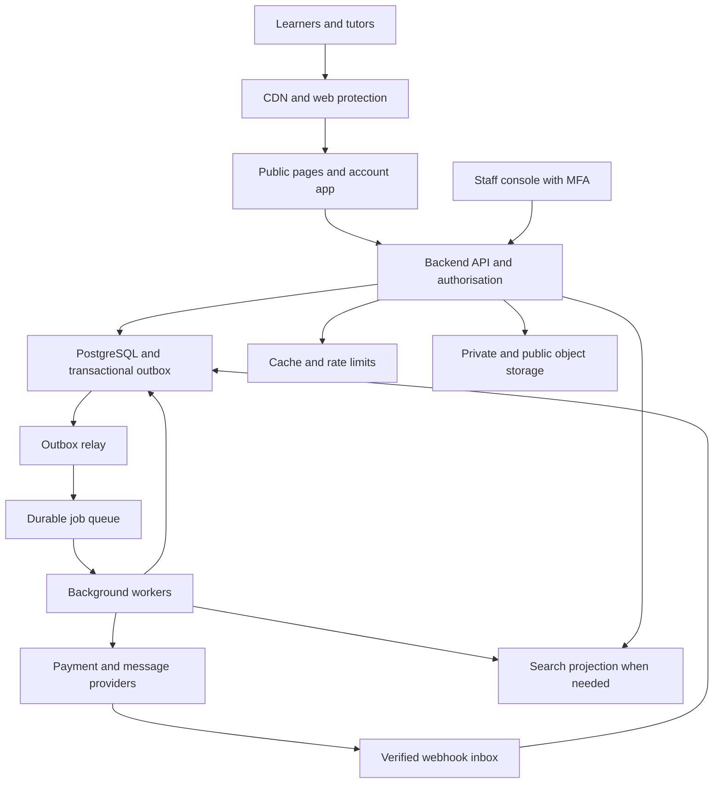
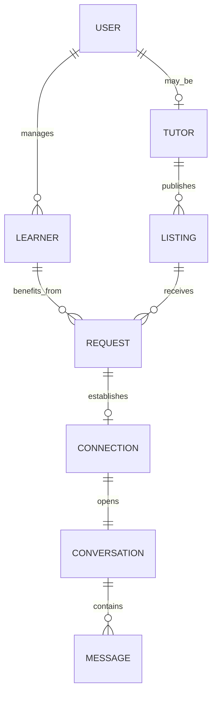
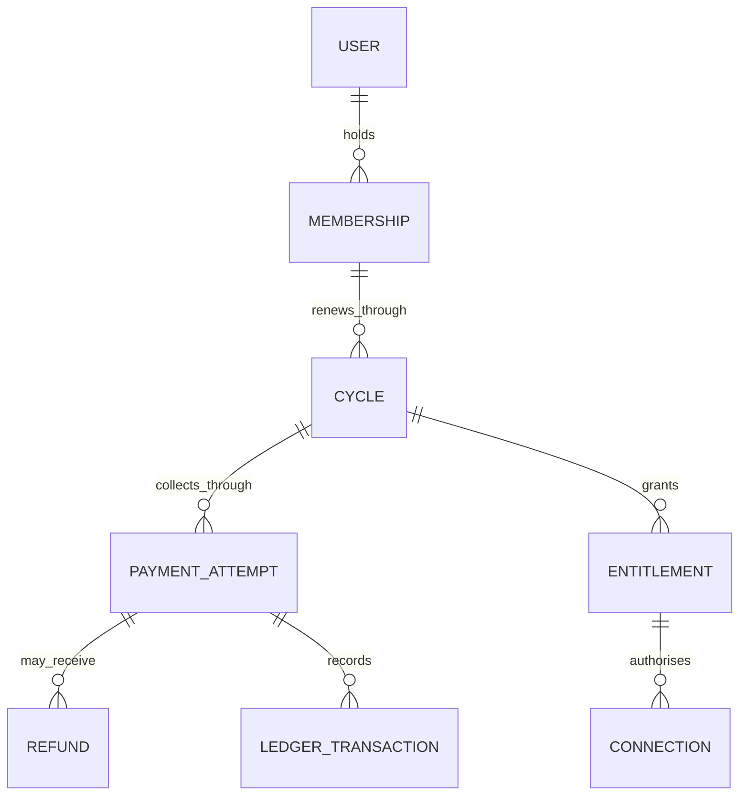
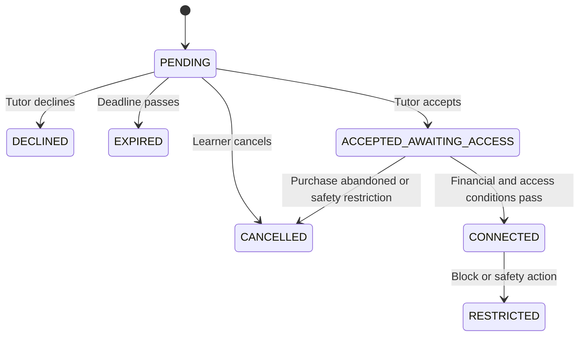
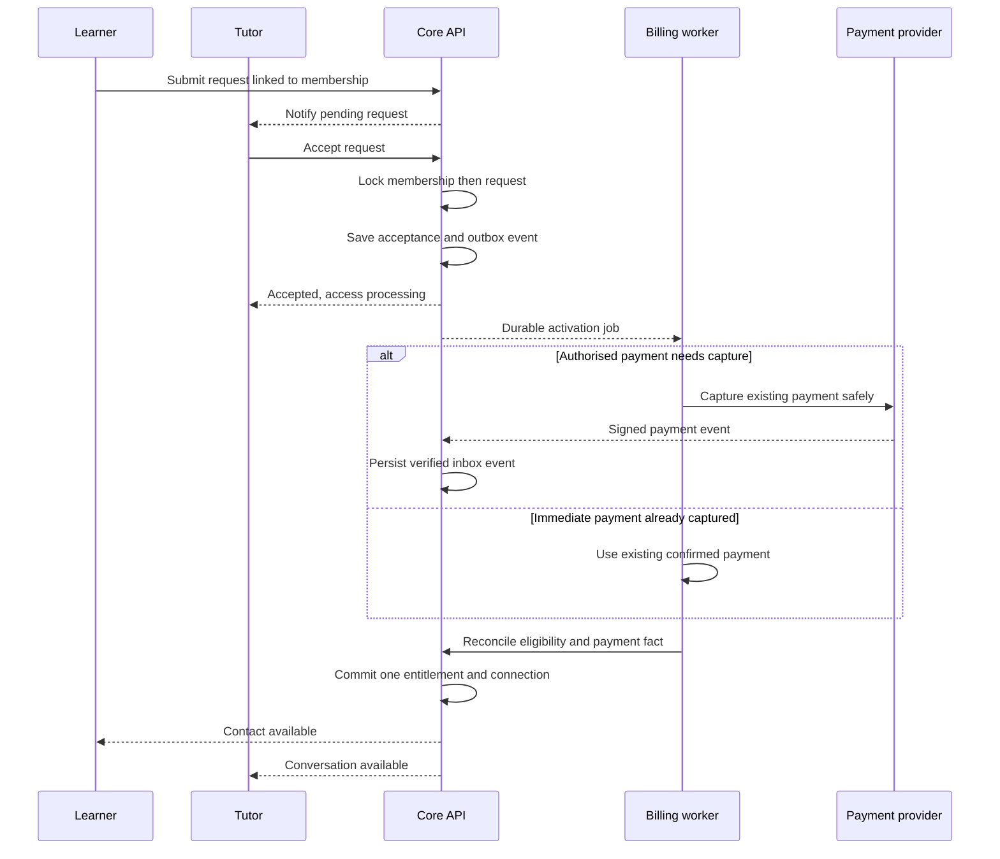

# Superprof India: business architecture, requirements, HLD and LLD

**Prepared for Ravi Shankar Nagar · Research date: 5 October 2026**

This is a practical blueprint for understanding—and building—a tutoring marketplace comparable to Superprof India. **It is not a claim about Superprof's private code, databases, cloud infrastructure, staffing, traffic or financial results.** Public product behaviour is identified separately from the proposed design.

The research uses official India help pages and terms surfaced in web retrieval. Some direct Superprof page fetches returned HTTP 405; indexed official content was available. Prices and policies below are published references, not a tested checkout quote. Sources conflict in a few places; those conflicts are recorded rather than silently resolved.

## How to read this blueprint

| Term | Simple meaning | What this document includes |
|---|---|---|
| Business architecture | Who gets value, who pays, and how the company operates | Customers, revenue, operations, acquisition, trust and economics |
| Functional requirements (FR) | What users and staff can do | Search, advertise, request a tutor, subscribe, message, review and resolve problems |
| Non-functional requirements (NFR) | How reliably and safely the system must work | Latency, availability, correctness, privacy, accessibility and recovery |
| High-level design (HLD) | Major building blocks and how they connect | Applications, backend modules, data stores, workers and providers |
| Low-level design (LLD) | Rules inside those building blocks | Entities, schemas, methods, APIs, state changes, transactions and failure handling |
| MVP | The smallest useful first launch | A working matching and subscription business, with support and billing controls |

**Evidence labels:** **Observed** = supported by public India material. **Proposed** = a design decision for a new business. **Extension** = useful later, but not established as part of the India core flow.

## 1. What business is Superprof?

Superprof is a two-sided marketplace. Tutors supply teaching services; learners and parents look for suitable tutors. The platform helps them discover each other, establish trust and make contact. Its India guide describes free tutor registration and optional tutor upgrades. [S01]

The important distinction is between **paying the platform for access** and **paying a tutor for teaching**. The India terms describe tuition being settled directly with tutors. [S02] Consequently, the core design is an access-subscription marketplace, with lesson management as a separate capability.

### 1.1 Publicly supported product behaviour

| Component | Observed public behaviour | Design implication | Evidence |
|---|---|---|---|
| Discovery | Search by subject and location; online and face-to-face options; profiles show rates and reviews | Subject catalogue, geographic search, public listing pages | [S03] |
| Tutor supply | Teachers create and maintain teaching advertisements without a mandatory subscription | Tutor onboarding and listing lifecycle | [S01], [S04] |
| Student Pass | The contact help page quotes ₹599; subscription help describes 30 days of access | Versioned product catalogue and time-bounded access rights | [S05], [S06] |
| First payment | Help describes charging after acceptance, with immediate debit for Paytm/UPI | Payment-method-specific timing; money state must be separate from access state | [S06] |
| Contact sharing | After acceptance, learners can communicate through messages and access contact details | Explicit connection and contact-release permission | [S07] |
| Tutor Pro Pass | Optional benefits include visibility, advertisement statistics and support | Separate tutor subscription and promotion policy | [S08] |
| Pro Pass published prices | Terms quote ₹600 monthly and ₹5,000 yearly | Store prices by version; confirm live offer before purchase | [S02] |
| Renewals | Terms describe automatic Student Pass renewal and account cancellation | Mandate management, renewal notices and self-service cancellation | [S02] |
| Replacement matching | A declined request can lead to offers from suitable available tutors | Matching fallback and learner-controlled selection | [S09] |
| Tutor reputation | Levels and badges depend on combinations of recommendations, reviews and verification | Rule-based badges with evidence and policy versions | [S10] |
| Reviews | Help permits reviews seven days after an accepted request and describes moderation | Request-linked review eligibility; do not assume lesson attendance was verified | [S11], [S12] |
| Recommendations | Teachers can invite acquaintances or former students to recommend them | Keep recommendations distinct from platform-linked reviews | [S13] |
| Notifications | Email and SMS support account and request activity; users have preferences | Durable notifications, templates and preference controls | [S14] |
| Listing control | Tutors edit and can deactivate/reactivate advertisements | Publication and availability controls | [S04], [S15] |
| Safety reports | Teachers can report a problem from a conversation | Reporting, moderation cases and restricted staff access | [S16] |

### 1.2 Conflicts and unknowns that affect architecture

| Topic | Research finding | Treatment in the proposed design |
|---|---|---|
| Payment responsibility | India terms specify direct tuition settlement; a separate India blog describes optional platform payment and a fee | Use direct tuition payment for the core. Treat collection and payouts as an extension requiring current product confirmation. [S02], [S17] |
| Response deadline | Help says 72 hours; terms mention possible suspension after 48 hours | Use separately configurable reminder, expiry and suspension rules. [S18], [S02] |
| Badge thresholds | Help and terms differ on review counts | Use versioned badge criteria; do not hard-code a claim of Superprof's current threshold. [S10], [S02] |
| Subscription detail | Some help wording is less explicit about renewal than the terms | Store the exact accepted offer, consent and renewal rules. [S19], [S02] |
| First free session | Public listings advertise trials; terms allow exceptions | Store each listing's trial duration, price and eligibility. Never equate a free trial with free platform access. [S03], [S02] |
| Replacement-triggered billing | Terms also describe a replacement-offer billing condition | Record this as a policy uncertainty; the proposed product requires explicit learner choice before activating a replacement. [S02] |
| Verification | Different pages make broad verification claims and describe additional checks for particular levels | Show exactly what was checked, when and by whom. A generic badge is insufficient evidence of teaching quality. [S03], [S10] |
| Internal implementation | Actual stack, schemas, cloud, ranking weights, load, revenue and profit were not established | Everything technical and numerical from section 3 onward is proposed or illustrative |

## 2. Business components and money flows

### 2.1 Participants and value

| Participant | Need | Value the marketplace delivers | Business risk |
|---|---|---|---|
| Adult learner | Find an appropriate teacher quickly | Comparable profiles, relevant matches and reliable contact | Paying without receiving a useful connection |
| Parent or guardian | Find suitable help for a child | Guardian-controlled contact, verified evidence, safety reporting | Privacy exposure or unsafe interactions |
| Independent tutor | Find serious students | Discovery, qualified enquiries, reputation and optional visibility tools | Low-quality enquiries or misleading paid promotion |
| Tutor organisation, later | Manage several instructors | Organisation accounts, permissions and consolidated reporting | Treating an agency as a single individual tutor |
| Marketplace operator | Sustain useful matches profitably | Subscriptions and optional additional services | Weak supply, acquisition cost, refunds and reputation damage |
| Support and moderation staff | Resolve exceptional situations | Case queues, context and controlled actions | Overbroad access or inconsistent decisions |
| Payment and communication providers | Process authorised transactions/messages | Contracted integrations | Downtime, delivery failures and reconciliation mismatches |

### 2.2 Core revenue model

| Revenue stream | Status | Who pays | What is sold |
|---|---|---|---|
| Student access subscription | Observed | Student or guardian | Ability to establish tutor contacts during an access period |
| Tutor Pro subscription | Observed | Tutor | Defined visibility and reporting benefits |
| Tuition | Tutor income in the core design | Student or guardian | Teaching delivered by the tutor |
| Commission on managed lesson payments | Extension | Contractually agreed party | Payment and transaction services |
| Institutional accounts | Extension | School, company or coaching organisation | Managed seat access and reporting |
| Premium classroom or learning tools | Extension | Tutor or learner | Optional productivity features |

For the observed revenue products, see [S01], [S05], [S08]. Optional rows are business possibilities, not claims about Superprof India.

**Example:** Suppose the access pass is ₹599 and a tutor independently charges ₹500 per hour. Four one-hour lessons cost ₹2,000 in tuition. The learner's combined outlay is ₹2,599 before any applicable additional charges. The platform does **not** earn the entire ₹2,599 in the direct-payment model. The ₹500 rate and four lessons are an example, not an average.

Track platform billings, recognised revenue, taxes, refunds and tutor teaching value separately. If tuition is paid outside the platform, its total is not fully observable; label survey-based lesson value as estimated rather than calling it audited GMV.

### 2.3 Complete operating capability map

These are proposed responsibilities. A small team can cover several roles; this is not Superprof's organisation chart.

| Capability | Routine work | Supporting software | Accountable role |
|---|---|---|---|
| Market selection | Choose cities, subjects, boards, languages and budgets to serve | Demand/supply dashboard | Founder or marketplace lead |
| Tutor acquisition | Recruit tutors, partnerships and referral outreach | Recruitment CRM and campaign attribution | Supply lead |
| Onboarding | Help tutors write profiles and publish valid offers | Onboarding funnel and review queue | Tutor success |
| Verification | Review submitted credentials and resolve mismatches | Evidence vault and verification case manager | Trust operations |
| Supply health | Pause unavailable tutors; identify unanswered requests | Availability and responsiveness dashboard | Marketplace operations |
| Learner acquisition | Search visibility, useful content, partnerships and paid campaigns | CMS, SEO pages and acquisition analytics | Growth |
| Matching | Improve relevance, coverage and time to response | Search, ranking and fallback suggestions | Product and marketplace operations |
| Pricing | Set plans, discounts and renewal policies | Versioned offers and experiments | Product and finance |
| Subscription operations | Failed renewals, cancellation and recovery | Billing console and mandate status | Billing operations |
| Customer support | No responses, confusion, cancellations and account issues | Ticket system and authorised action tools | Support lead |
| Safety and moderation | Reports, harassment, fraudulent documents and review manipulation | Case queues, blocking and appeals | Trust lead |
| Finance | Reconcile gateway transactions, refunds, fees and bank settlements | Ledger, reports and accounting export | Finance |
| Legal and privacy | Approve disclosures, retention, child-account and vendor policies | Consent records and privacy workflow | Legal/privacy owner |
| Engineering | Build product, maintain integrations and release safely | CI/CD and issue tracking | Engineering lead |
| Reliability | Monitor service and recover incidents | Metrics, alerts, runbooks and backups | On-call engineer |
| Quality assurance | Verify money, access, identity and recovery behaviour | Acceptance and integration tests | Engineering/QA |
| Data analysis | Evaluate matches, acquisition, retention and marketplace fairness | Event pipeline and warehouse | Analyst/product owner |
| Vendor management | Monitor costs, delivery and service quality | Vendor inventory and usage budgets | Operations/engineering |

## 3. Scope and core product decisions

The proposed first launch serves India, supports INR, allows online and in-person tutoring, and targets a deliberately limited initial subject/city catalogue. It uses a responsive website for students, guardians, tutors and staff.

### 3.1 Three product layers

| Layer | Scope | Included when |
|---|---|---|
| A: Contact marketplace | Accounts, listings, discovery, verification, requests, pass billing, connections, messaging, reviews and support | Core MVP |
| B: Lesson coordination | Calendar proposals, conflict prevention, reminders and externally hosted meeting links | After the core works, or earlier if a launch customer requires it |
| C: Managed transactions and learning | Lesson checkout, payouts, disputes, classroom, resources and progress tracking | Separate business and engineering expansion |

An accepted contact request is **not** a confirmed lesson. A lesson proposal is **not** proof of attendance. A paid subscription is **not** proof that a class happened.

### 3.2 Proposed business rules

1. A person can have student and tutor roles on the same account; roles do not create duplicate identities.
2. A guardian is the payer/contact account for a child; a separate learner profile records the beneficiary.
3. Browsing is free. New contact requests require either active access or an explicitly initiated first-purchase flow.
4. Tutor acceptance and payment confirmation are independent facts. A new paid connection requires both, unless a previously paid entitlement valid at submission already covers it.
5. One learner contacting several tutors pays once for the same access period, not once per acceptance.
6. For an immediate-payment method, captured funds wait for matching; the access clock starts on a qualifying acceptance. This is a proposed policy, not a verified detail of Superprof's implementation.
7. If no match arrives by the disclosed purchase deadline, cancel any remaining authorisation or start a refund for captured funds. Pending requests expire consistently with that decision.
8. Cancelling renewal preserves access until its paid end. It does not erase existing tutor connections.
9. Pending requests sent during paid access may be accepted until their recorded expiry without a second charge. They retain the entitlement that authorised submission.
10. Already established connections remain usable after pass expiry, subject to blocking, suspension and safety decisions. New contacts require renewed access.
11. A refund ends future acquisition rights according to the adjudicated outcome. Contact information already disclosed cannot be made unknown; do not promise to retract it.
12. Public pages never expose private phone numbers, email addresses, documents or precise home addresses.
13. Badge rules, prices, refund rules and request time limits are versioned policies, not scattered constants.
14. Optional paid promotion must not bypass subject relevance, safety restrictions or availability filters.
15. Reviews and recommendations are different evidence types. A request-linked review does not claim platform-verified lesson completion.

## 4. Functional requirements

**Priority:** P0 = required to operate the core paid marketplace; P1 = first improvements; P2 = later expansion. These are proposed requirements, including features inspired by observed behaviour.

### 4.1 Accounts, tutors and discovery

| ID | Requirement | Minimum acceptance condition | Priority |
|---|---|---|---|
| FR-01 | Register and sign in | Email/phone ownership verified; password reset or OTP expires; duplicate identity handled safely | P0 |
| FR-02 | Manage account sessions and roles | User can sign out devices; tutor role does not grant admin access | P0 |
| FR-03 | Manage learner and guardian profiles | Guardian authority required for child contact; child data stays out of public pages | P0 if minors served |
| FR-04 | Create tutor profile | Name, biography, languages and teaching background have field validation and preview | P0 |
| FR-05 | Upload verification evidence | Private upload, scan, staff decision and precisely scoped verification result | P0 |
| FR-06 | Create subject listings | Each offer declares subject, level, mode, rate, location/service area and trial terms | P0 |
| FR-07 | Publish, edit, pause and resume listings | Only approved, active offers appear publicly; sensitive edits can return to review | P0 |
| FR-08 | Search and filter tutors | Combine subject, city/radius, online mode, budget, language and learner level | P0 |
| FR-09 | View tutor detail | Show price unit, mode, trial terms, evidence, reviews and availability status consistently | P0 |
| FR-10 | Handle no results | Offer sensible wider-location/online alternatives without silently changing the user's filters | P0 |
| FR-11 | Save favourites | User can add/remove a tutor; removed or suspended listings are not promoted | P1 |
| FR-12 | Explain recommendations | Show relevant match reasons and distinguish paid placement where applicable | P1 |

### 4.2 Contact, subscriptions and billing

| ID | Requirement | Minimum acceptance condition | Priority |
|---|---|---|---|
| FR-13 | Send a contact request | Record subject, learner goal, mode, preferred times, expiry and accepted policy version | P0 |
| FR-14 | Tutor accepts or declines | Only target tutor can respond; duplicate actions are harmless; state conflicts return clearly | P0 |
| FR-15 | Recover from no response | Reminders and expiry use recorded deadlines; alternatives require learner selection | P0 |
| FR-16 | Display and sell a Student Pass | Checkout separates platform charge from tuition and discloses duration and renewal | P0 |
| FR-17 | Process first payment | Each supported method has an explicit debit/authorisation strategy and failure path | P0 |
| FR-18 | Activate access and release contact | Grant only after eligibility and verified payment; preserve one charge across concurrent tutor acceptances | P0 |
| FR-19 | Manage renewals | Only a valid authorised recurring arrangement can renew; failed renewal is visible and retriable | P0 if recurring |
| FR-20 | Cancel renewal | Self-service action stops future charge initiation; UI displays remaining access and provider status | P0 |
| FR-21 | Issue refund and resolve chargeback | Link every adjustment to the original payment, reason, approver and provider result | P0 |
| FR-22 | View receipts and payment history | Authorised owner sees captured charges, refunds and applicable invoice information | P0 |
| FR-23 | Sell a tutor Pro plan | Optional offer has explicit benefits, term and cancellation rules; no promise of guaranteed students | P1 |
| FR-24 | Apply promotions | Validate dates, limits, audience and redemption atomically; display final payable price | P1 |

### 4.3 Communication, reputation and operations

| ID | Requirement | Minimum acceptance condition | Priority |
|---|---|---|---|
| FR-25 | Send and receive messages | Only connection participants or authorised guardians can read/write; retries cannot duplicate messages | P0 |
| FR-26 | Share permitted attachments | Enforce type/size limits, malware checks, authorised download and retention | P1 |
| FR-27 | Send notifications | Durable delivery attempts, preference checks, deduplication and account/request templates | P0 |
| FR-28 | Leave a review | Eligibility derived from request/connection evidence; one review per reviewer/connection/direction; moderation and appeal | P0 |
| FR-29 | Receive recommendations | Record relationship disclosure and invitation verification; label separately from reviews | P1 |
| FR-30 | Calculate tutor badges | Use auditable evidence and rule version; revoked credentials trigger recalculation | P1 |
| FR-31 | Block and report | Blocking immediately affects authorisation; report creates a case without notifying the reported party of private evidence | P0 |
| FR-32 | Run support cases | Staff can inspect permitted context, communicate through support, escalate and record resolution | P0 |
| FR-33 | Moderate accounts/listings/reviews | Reason, duration, evidence and appeal path for each action; search and caches update | P0 |
| FR-34 | Administer catalogue and policies | Controlled publication of subjects, levels, locations, plans, legal text and templates | P0 |
| FR-35 | Export or delete account data | Identity confirmation, queue progress, retention exceptions and completion records | P0 |
| FR-36 | Measure product and finance | Event definitions distinguish requested, accepted, connected, paid and taught | P0 |
| FR-37 | Manage SEO content | Useful subject/city pages, valid metadata, canonical links and sitemaps | P0 |
| FR-38 | Track tutor performance | Tutor sees views and qualified requests with definitions; staff sees supply responsiveness | P1 |

### 4.4 Optional lesson platform

| ID | Requirement | Minimum acceptance condition | Priority |
|---|---|---|---|
| FR-39 | Propose and confirm lessons | Both parties agree on time, duration, mode and rate snapshot; no tutor overlap | P1 |
| FR-40 | Reschedule and cancel | Retain history; apply agreed cancellation policy; notify both parties | P1 |
| FR-41 | Coordinate an online meeting | Authorised meeting link, reminder and fallback provider; no public join link | P1 |
| FR-42 | Collect tuition through platform | Distinct order type; refund policy, fees and payee onboarding approved before launch | P2 |
| FR-43 | Settle tutor earnings | Provider settlement, ledger, payout hold and reconciliation prevent overspending liabilities | P2 |
| FR-44 | Offer classroom and resources | Access tied to participants; recording needs separate consent and retention policy | P2 |
| FR-45 | Support group lessons/organisations | Session capacity and staff roles replace assumptions about one learner and one tutor | P2 |
| FR-46 | Personalise with ML | Baseline comparison, consent-appropriate data, fairness review and deterministic fallback | P2 |

## 5. Non-functional requirements

The following are **initial design targets**, not measured Superprof service levels. Load-test and negotiate them before treating them as contractual commitments.

| ID | Area | Proposed measurable target | Implementation consequence |
|---|---|---|---|
| NFR-01 | Availability | Core API monthly availability ≥99.9%; approximately 43.2 minutes error budget in a 30-day month | Multiple application instances, health checks and managed database failover |
| NFR-02 | Search latency | p95 server response ≤500 ms at stated launch peak | Appropriate indexes, bounded filters, pagination and query monitoring |
| NFR-03 | Public page performance | p75 LCP ≤2.5 s on agreed mobile/network test profile | Server-rendered pages, compressed images and controlled JavaScript |
| NFR-04 | Transaction latency | p95 first-party account/request writes ≤500 ms, excluding external payment time | Short transactions; external work asynchronous |
| NFR-05 | Chat | p95 durable message acknowledgement ≤300 ms; connected-recipient delivery ≤1 s under normal network conditions | Persist before acknowledgement, replay on reconnect |
| NFR-06 | Billing correctness | At most one successful business charge per product cycle; duplicate events do not duplicate grants or postings | Database uniqueness, idempotency and reconciliation |
| NFR-07 | Contact privacy | Zero authorised test cases exposing another user's contacts/messages without a grant | Object-level permission checks on every read/write |
| NFR-08 | Durability | No loss of acknowledged writes during a tested single-node/AZ failure with synchronous database configuration | Verify actual managed database replication behaviour |
| NFR-09 | Disaster recovery | Regional-disaster RPO ≤5 min and RTO ≤60 min as initial objectives | Protected backup/WAL strategy, restore automation and drill evidence |
| NFR-10 | Search freshness | Listing edits visible within 60 s p95; contact actions recheck live eligibility immediately | Versioned index updates and authoritative final checks |
| NFR-11 | Notifications | 99% of critical events submitted to a provider within 60 s | Outbox, retries and queue-age alarms; delivery itself depends on provider |
| NFR-12 | Security | TLS, encryption at rest, staff MFA, least privilege and no raw card/CVV storage | Managed secrets, hosted payments and restricted data stores |
| NFR-13 | Accessibility | Target WCAG 2.2 AA on core flows; keyboard and screen-reader acceptance checks | Form labels, focus control, error announcements and contrast |
| NFR-14 | Maintainability | Modules own their data and policies; breaking migrations use staged rollout | Contract tests, versioned events and expand/contract migrations |
| NFR-15 | Auditability | Every staff financial/safety action has actor, target, reason, before/after reference and timestamp | Append-only audit records with restricted access |
| NFR-16 | Observability | Trace a request through payment, grant and notification using correlation identifiers | Structured logs, metrics and traces without message bodies or secrets |
| NFR-17 | Localisation | INR stored as integer paise; UTC instants plus IANA display time zones | No floating-point money or hard-coded time offsets |
| NFR-18 | Capacity | Meet a defined peak of 350 dynamic requests/s with headroom in the growth example | Scale stateless application and workers independently |
| NFR-19 | Cost control | Track cost per active account, qualified request and paid connection monthly | Vendor quotas, attachment limits, budgets and lifecycle policies |
| NFR-20 | Deletion and retention | Each data class has an approved retention rule; completed deletions propagate to search, cache and analytics | Deletion orchestration and restore-time reapplication of tombstones |

A 99.9% target does not make a single-server deployment highly available. Likewise, RPO/RTO values are objectives until tested; asynchronous regional replication can lose recent writes. Gateway reconciliation must recover payment facts after a disaster.

## 6. High-level design

### 6.1 Recommended initial architecture

Use a **modular monolith**: one backend codebase and deployable API, organised into separately owned business modules. Workers may run the same codebase in separate processes. This keeps cross-module financial and access transactions straightforward while allowing later extraction.



PostgreSQL is the authority for money, requests, access and private conversation data. A cache or search index is replaceable. At MVP scale, search can query indexed PostgreSQL directly; the separate projection is introduced only when relevance or volume justifies it.

### 6.2 Domain modules and ownership

| Module | Owns | Exposes | Depends on |
|---|---|---|---|
| Identity | Accounts, sessions, role grants, account status | Sign-in, session checks, user lifecycle | Email/OTP adapter |
| Learners and guardians | Learner profiles, guardian authority | Learner access checks | Identity |
| Tutor catalogue | Profiles, offers, subjects, rates and availability summary | Publish/edit/read listings | Identity, trust decisions |
| Trust | Verification cases, evidence decisions, blocks and sanctions | Eligibility and verification facts | Identity, private storage |
| Discovery | Search projection and ranking configuration | Search/filter/rank | Catalogue and trust facts |
| Requests | Search intents, contact requests and tutor decisions | Request, accept, decline, expire | Identity, catalogue, access |
| Subscriptions | Membership, product cycles, entitlements and renewal intent | Access check and lifecycle | Billing, policy catalogue |
| Billing | Checkout attempts, provider references, refunds and reconciliation | Authorise/capture/refund/status | Payment adapter |
| Connections | Tutor-learner grants and contact release | Establish/read/revoke connection | Requests, entitlements, trust |
| Messaging | Conversations, messages and read positions | Durable send/read and realtime delivery | Connections, trust |
| Reputation | Reviews, recommendations, published aggregates and badges | Submit/moderate/evaluate | Connections, trust |
| Notifications | Templates, preferences and delivery attempts | Queue and deliver notifications | Domain events, email/SMS adapters |
| Support | Tickets, internal notes and action workflows | Staff case operations | Narrowly scoped domain commands |
| Content and growth | CMS pages, campaigns, attribution and promo rules | Public content and acquisition reports | Catalogue, analytics |
| Finance | Journal, settlement imports and exception queue | Reconciliation and accounting export | Billing facts |
| Privacy | Consent, data export/deletion and retention jobs | Data-rights requests and execution | All personal-data owners |
| Lesson coordination | Calendar proposals and bookings | Propose, hold, confirm, reschedule | Connections, catalogue |
| Analytics | Event definitions and derived reporting | Funnel, supply and cohort reports | Redacted domain events |

Keep modules separate logically; do not deploy eighteen microservices merely because the table has eighteen rows. Public controllers call application services; application services use domain rules and repositories. Only a module writes its owned data through its command interface.

### 6.3 Synchronous and asynchronous work

| Synchronous path | Why it waits | Asynchronous side effects |
|---|---|---|
| Authenticate user | Required before private action | Login notification and risk review |
| Create request | Must validate entitlement, tutor status and duplicates | Tutor notification, reminders and analytics |
| Accept request | Must commit one consistent decision | Capture/activation coordination and messages |
| Send chat message | Must persist and authorise content | Realtime fan-out and offline alert |
| Cancel renewal | Must record user intent immediately | Provider cancellation, confirmation and reconciliation |
| Upload document metadata | Must assign private ownership | Malware scan and review routing |
| Publish listing | Must validate publication permission | Search indexing, CDN invalidation and SEO update |

Do not keep a database transaction open while making an external HTTP call. Store the intended side effect transactionally, then execute it with a retryable worker.

### 6.4 Example implementation stack

This is a proposed stack, not a reverse-engineered Superprof stack. Use supported stable versions at implementation time.

| Layer | Suitable initial choice | Reason and boundary |
|---|---|---|
| Web UI | TypeScript, React and Next.js | Public server-rendered tutor pages and interactive account screens; Next.js documents hybrid rendering and metadata. [T01] |
| Backend | TypeScript modular backend, e.g. NestJS | Clear module/controller/service boundaries; one language across web and API |
| Relational data | Managed PostgreSQL; PostGIS if radius search requires it | Transactions, constraints, joins and geospatial queries |
| Cache | Managed Redis or equivalent | Rate limiting, short-lived public cache and realtime coordination; no authoritative balance |
| Jobs | Managed durable queue and worker processes | Reliable reminders, billing reconciliation and notifications |
| Search | PostgreSQL first; dedicated search engine later | Avoid paying operational complexity before search needs it |
| Files | Managed object storage with signed upload/download | Separate public profile assets from private evidence |
| Payments | India-capable hosted payment provider with required methods | Confirm recurring and delayed-capture capabilities for your account and methods |
| Messaging delivery | WebSocket gateway plus durable HTTP history API | Realtime experience with recovery after disconnects |
| Email/SMS | Provider adapters and delivery webhooks | Replace vendor without rewriting business policy |
| Analytics | Structured events; warehouse when reporting outgrows operational SQL | Keep heavy reporting off the transaction database |
| Deployment | Managed container/application service, private database network and secrets manager | Small operational footprint with repeatable releases |

Python/FastAPI is also a reasonable backend choice if it is the team's strongest language. Choose one principal business backend; adding Python is useful later for ML workloads, not required to run a tutoring marketplace.

### 6.5 Scaling path

First add indexes, caching, connection pooling and adequate database capacity. Next scale stateless API and worker instances. Add a dedicated search projection when needed. Split realtime messaging if its connections and load dominate. Extract billing only after a team can maintain its stronger consistency, integration and incident requirements.

A read replica is suitable for tolerant public reads and analytics. Contact release, renewal cancellation and payment decisions read authoritative data. A stale replica must not grant access or undo a suspension.

## 7. Capacity and storage assumptions

These numbers are a planning scenario, not Superprof statistics.

| Assumption | Value | Derived load |
|---|---:|---|
| Registered accounts | 1,000,000 | Does not mean one million daily users |
| Tutor profiles | 100,000 | Suppose 150,000 active listings |
| Daily active accounts | 50,000 | Basis for dynamic request estimate |
| Dynamic requests per active account/day | 60 | 3,000,000 requests/day |
| Average API rate | — | 3,000,000 / 86,400 ≈ 34.7 requests/s |
| Peak multiplier | 10× | Approximately 350 requests/s |
| Search requests/day | 500,000 | Approximately 5.8/s average, 58/s at 10× peak |
| Contact requests/day | 20,000 | Approximately 600,000 in a 30-day month |
| Chat messages/day | 500,000 | Approximately 15 million per 30-day month |
| Concurrent realtime connections | 10,000 assumed | Size separately from HTTP throughput |
| Logical message storage | 1 KB/message assumed | Approximately 15 GB/month before indexes, replication, logs or attachments |
| Tutor media | 2 MB/profile assumed | Approximately 200 GB for 100,000 profiles |

A 12-month archive at that message rate is about 180 million messages and 180 GB of logical payload alone. Actual provisioned storage may be several times larger. Measure index amplification, attachments, WAL, backups and retention before capacity purchase.

Use cursor pagination, bounded search radius and message page size, attachment limits, per-user request limits, and database pool limits. Do not choose shard counts from registered-account count alone.

## 8. LLD: data model and ownership

### 8.1 Common data conventions

Use opaque UUID identifiers, UTC `timestamptz` instants, and integer minor-unit amounts with an ISO currency code. User-visible dates use the user's IANA time zone. Save an explicit price and policy snapshot on every commercial commitment; editing a tutor rate or pass price must not rewrite history.

Add `created_at`, `updated_at` and a concurrency `version` where appropriate. Use foreign keys, check constraints and uniqueness for invariants, rather than trusting only request validation. Separate public profile fields from private identity and evidence. Soft deletion supports immediate access revocation; a retention workflow later removes or anonymises data according to approved policy.

### 8.2 Identity, supply and safety tables

| Table | Important columns | Keys or constraints |
|---|---|---|
| `users` | id, normalised_email, phone_e164, status, locale, timezone | Unique verified identity where applicable; null email/phone handled deliberately |
| `auth_identities` | id, user_id, provider, provider_subject, password_hash | Unique `(provider, provider_subject)`; password hash only for password identity |
| `sessions` | id, user_id, token_hash, expires_at, revoked_at | Never store a usable session secret in logs |
| `user_roles` | user_id, role | Unique `(user_id, role)`; separate restricted staff roles |
| `learner_profiles` | id, account_id, display_name, age_band, education_level | Minimise child data; owner is payer/guardian account |
| `guardian_links` | id, guardian_user_id, learner_id, verification_state, consent_version | Only verified authorised links grant child-account access |
| `tutor_profiles` | id, user_id, public_name, bio, status, timezone, aggregate_version | Unique user_id; status independent of subscription |
| `subjects` | id, parent_id, slug, name, active | Unique slug; taxonomy hierarchy |
| `locations` | id, parent_id, country_code, locality, approximate_geo | Public locality distinct from private address |
| `listings` | id, tutor_id, primary_subject_id, title, description, publication_state, availability_state | Listing belongs to one tutor |
| `listing_subjects` | listing_id, subject_id | Unique pair for related subject coverage |
| `listing_levels` / `listing_languages` | listing_id, level_id or language_code | Unique pairs; valid reference catalogue |
| `listing_offers` | id, listing_id, mode, rate_minor, currency, billing_unit, trial_minutes, trial_price_minor | Nonnegative amounts; rate unit and trial terms explicit |
| `listing_service_areas` | listing_id, location_id, centre_geo, radius_metres, venue_type | Online offers do not need distance filtering |
| `availability_rules` / `availability_exceptions` | tutor_id, local recurrence or UTC interval, timezone, effective_dates | Recurrences interpreted in tutor's named time zone |
| `assets` | id, owner_user_id, object_key, class, mime, size, scan_state, retention_class | No public bucket for evidence or attachments |
| `verification_cases` | id, tutor_id, check_type, evidence_asset_id, status, reviewer_id, verified_at, expires_at | Badge says which check passed; audit every decision |
| `user_blocks` | blocker_id, blocked_id, created_at | Unique pair; effective in both contact and message checks |
| `moderation_cases` / `moderation_actions` | case_id, reporter, target, evidence_refs; action, actor, reason, expires_at | Evidence access limited to assigned/authorised staff |

### 8.3 Requests, subscription and financial tables

| Table | Important columns | Keys or constraints |
|---|---|---|
| `search_intents` | id, payer_user_id, learner_id, subject, mode, budget, locality, goal | Stores explicit learner requirements, not hidden inferred sensitive traits |
| `contact_requests` | id, intent_id, requester_id, tutor_id, listing_id, membership_id, submitted_entitlement_id, status, expires_at, policy_version | Unique active requester/listing/learner request; tutor ownership enforced |
| `request_events` | id, request_id, event_type, actor_id, occurred_at, reason | Append-only request decision history |
| `match_suggestions` | id, intent_id, tutor_id, listing_id, reason_codes, status | Suggestion alone cannot create a financial authorisation |
| `plan_versions` | id, product, market, price_minor, currency, term, renewal_mode, effective_from, policy_version | Immutable once used; term can be 30 days or calendar month, explicitly |
| `memberships` | id, payer_user_id, product, market, status, cancel_at_period_end, version | Unique `(payer_user_id, product, market)`; stable lock target |
| `subscription_cycles` | id, membership_id, cycle_no, plan_version_id, amount_minor, currency, start_at, end_at, state | Unique `(membership_id, cycle_no)`; one logical payable per cycle |
| `payment_attempts` | id, cycle_id, provider, provider_order_id, provider_payment_id, state, operation_key, authorised_until | Unique provider identifiers where present; retry is not a new obligation |
| `payment_operations` | id, payment_attempt_id, operation_type, operation_key, state, lease_until, last_error | Unique operation_key; records uncertain external outcomes |
| `payment_webhook_inbox` | provider, event_id, raw_payload_ref, received_at, processing_state | Unique `(provider, event_id)`; raw-body signature checked before acceptance |
| `entitlements` | id, cycle_id, user_id, capability, valid_from, valid_until, revoked_at | Unique grant per cycle/capability; validate period and revocation |
| `connection_grants` | id, request_id, student_account_id, learner_id, tutor_id, entitlement_id, state, established_at | Unique request_id; records the evidence for contact release |
| `billing_mandates` | id, membership_id, provider_ref, consent_id, status, cancel_requested_at, cancelled_at | A successful one-time UPI payment is not a recurring mandate |
| `refunds` | id, payment_attempt_id, amount_minor, reason, state, operation_key, provider_ref | Sum of pending and completed refunds cannot exceed captured refundable amount |
| `chargebacks` | id, payment_attempt_id, provider_case_id, amount_minor, state, response_deadline | Unique provider case; separate from voluntary refunds |
| `invoices` / `invoice_lines` | id, payer, cycle_id, tax_snapshot, totals; description, amount | Immutable issued document; corrections via appropriate adjustment document |
| `ledger_transactions` / `ledger_entries` | id, business_key, currency, posted_at; account_id, debit_minor, credit_minor | Unique business_key; balanced entries per currency enforced at posting |
| `settlement_imports` / `reconciliation_items` | provider_statement_id, bank_ref; expected, observed, difference, resolution | Imported lines deduplicated; unresolved differences remain visible |
| `promotions` / `promotion_redemptions` | code, rules_version, budget; user_id, cycle_id, redeemed_amount | Atomic usage/budget limit; prevent duplicate redemption |

### 8.4 Conversations, operations and extensions

| Table | Important columns | Keys or constraints |
|---|---|---|
| `conversations` | id, connection_grant_id, state, next_sequence | Unique connection grant in core; no arbitrary participant addition |
| `conversation_participants` | conversation_id, user_id, role, joined_at, removed_at, last_read_sequence | Unique pair; guardian role explicitly authorised |
| `messages` | id, conversation_id, sender_id, client_message_id, sequence, content_ref, sent_at | Unique `(conversation_id, sender_id, client_message_id)` and `(conversation_id, sequence)` |
| `message_assets` | message_id, asset_id | Asset ownership and authorised conversation scope checked |
| `reviews` | id, connection_id, reviewer_id, target_id, rating, text, state, evidence_type | One per connection/reviewer/target; rating 1–5; no self-review |
| `recommendations` | id, tutor_id, invitation_id, author_identity, relationship, text, state | Independent recommendation type and labels |
| `recommendation_invites` | id, tutor_id, token_hash, expires_at, redeemed_at | Single-use/limited-use invitations with rate controls |
| `tutor_badges` | tutor_id, badge, rule_version, evidence_refs, awarded_at, revoked_at | Paid status cannot masquerade as identity verification |
| `notification_preferences` | user_id, event_category, channel, enabled | Separate service and marketing preferences |
| `notification_deliveries` | id, event_id, recipient_id, channel, template_version, attempt, status | Unique logical delivery key; provider attempts may be multiple |
| `support_tickets` / `support_notes` | id, owner, category, severity, state, assigned_to; restricted notes | Scoped read permission; privileged operations use domain APIs |
| `consents` | id, user_id, purpose, document_version, presented_hash, granted_at, withdrawn_at | Record actual accepted disclosure and actor, including guardian |
| `privacy_requests` | id, user_id, type, verification_state, state, retention_exceptions | Export links expire; deletion has tracked sub-jobs |
| `policy_versions` | id, market, policy_type, document_ref, effective_at | Referenced by requests, plans and decisions |
| `content_pages` | id, slug, market, locale, status, version, published_at | Sanitised content and publish permission |
| `outbox_events` | event_id, aggregate_type, aggregate_id, aggregate_version, type, payload, published_at | Written with domain transaction; may be published more than once |
| `consumer_inbox` | consumer_name, event_id, processed_at | Unique pair; protects side effects from replay |
| `api_idempotency` | actor_id, route, key, request_hash, result_ref, state, expires_at | Unique actor/route/key; same key with different body is rejected |
| `audit_logs` | actor_id, action, target, reason, correlation_id, occurred_at | Append-only restricted record, with redacted sensitive fields |
| `lesson_bookings` | id, connection_id, tutor_id, learner_id, start_at, end_at, status, quoted_price, mode, policy_version | Extension; no overlapping held/confirmed tutor interval |
| `lesson_change_requests` | id, booking_id, proposed_interval, proposer, state | Accept atomically; old slot stays until replacement secured |
| `lesson_orders` / `payouts` | booking_id, paid_amount, settlement_state; tutor_id, amount, provider_ref | Managed-payment extension only; independent from pass billing |

This catalogue is logical: small implementations can combine closely related reference tables. It is not a demand to create every extension on day one.

### 8.5 Key entity relationships





These are simplified views. A connection stores both the learner beneficiary and payer/contact account. An account's tutor and student roles remain independent.

### 8.6 Important indexes

| Access pattern | Index or constraint |
|---|---|
| Account lookup | Unique normalised email/provider identity; indexed phone lookup where permitted |
| Public tutor search | Publication/availability, subject, location and mode indexes; geospatial index for radius search |
| Tutor request inbox | `(tutor_id, status, created_at DESC, id)` |
| Learner request history | `(requester_id, created_at DESC, id)` |
| Request expiry worker | Partial index on `expires_at` for pending requests |
| Subscription renewal | Partial index on `end_at` for eligible active cycles; membership status checked again under lock |
| Active capability lookup | `(user_id, capability, valid_until)` with revocation validation |
| Conversation history | Unique `(conversation_id, sequence)` for cursor reads |
| Provider event processing | Unique provider/event pair; processing state and received time for retry queue |
| Unpublished events | Partial index on unpublished outbox rows ordered by creation |
| Published reviews | `(target_id, state, created_at DESC)` |
| Support workload | `(assigned_to, state, severity, created_at)` |

Do not add indexes to every field. Examine realistic query plans and write amplification. Large message/event tables may later use time partitioning, with uniqueness and retention designed for the chosen partition key.

## 9. LLD: domain services and interfaces

| Service/interface | Principal operations | Invariants it protects |
|---|---|---|
| `IdentityService` | `register`, `verifyContact`, `authenticate`, `revokeSession` | Identity ownership and session validity |
| `TutorService` | `createProfile`, `submitListing`, `publish`, `pause` | Listing ownership and publication eligibility |
| `VerificationService` | `submitEvidence`, `review`, `revokeVerification` | Evidence scope, reviewer authority and badge truthfulness |
| `SearchService` | `search`, `explainMatch`, `suggestAlternatives` | Hard eligibility filters before ranking |
| `RequestService` | `create`, `accept`, `decline`, `expire`, `cancel` | Request participant authority and legal transitions |
| `AccessPolicy` | `canCreateRequest`, `canConnect`, `canRevealContact`, `canMessage` | Subscription access distinct from connection and safety permissions |
| `SubscriptionService` | `startPurchase`, `activateCycle`, `renew`, `cancelRenewal` | One stable membership and one access period per cycle |
| `BillingService` | `startAttempt`, `requestCapture`, `applyProviderFact`, `refund` | One obligation, safe retries and provider-state reconciliation |
| `PaymentGateway` | `createCheckout`, `fetchPayment`, `captureIfSupported`, `refund`, `cancelMandate` | Provider details hidden behind capability-aware adapter |
| `ConnectionService` | `establish`, `getContact`, `restrict`, `restore` | Both match and financial eligibility; no accidental contact leak |
| `MessagingService` | `send`, `history`, `markRead`, `subscribeRealtime` | Participant checks, durable acknowledgement and deduplication |
| `ReviewService` | `checkEligibility`, `submit`, `moderate`, `appeal` | Evidence type, uniqueness and publication state |
| `NotificationService` | `enqueue`, `render`, `deliver`, `applyReceipt` | Preference and consent checks, delivery deduplication |
| `LessonService` | `propose`, `hold`, `confirm`, `reschedule`, `cancel` | Tutor scheduling and immutable commercial snapshot |
| `ReconciliationService` | `importStatement`, `compare`, `resolveDifference` | Internal payment records agree with external facts |

Methods accept an authenticated actor context, validated command and correlation identifier. They return typed results, rather than giving controllers unrestricted database access. Repository methods that lock records make their locking behaviour explicit.

## 10. LLD: state machines

### 10.1 Tutor listing

`DRAFT → IN_REVIEW → PUBLISHED`; a reviewer may return `CHANGES_REQUESTED` or `REJECTED`. Published offers can become `PAUSED`, `SUSPENDED` or `ARCHIVED`. The tutor can resume a voluntary pause; only authorised staff can remove a safety suspension. Credential or pricing edits can trigger review without publishing unapproved content.

### 10.2 Contact request



Initial request text can be delivered to the tutor without revealing private contact data. The `ACCEPTED_AWAITING_ACCESS` state makes it possible to tell a learner that a tutor accepted even if payment still needs attention. Tutor acceptance must not manufacture payment success.

### 10.3 Subscription, cycle and payment

| Object | States or fields | Explanation |
|---|---|---|
| Membership | `INCOMPLETE`, `WAITING_FOR_MATCH`, `ACTIVE`, `PAST_DUE`, `EXPIRED`, `SUSPENDED` | Long-lived relationship between account and product |
| Renewal intention | `cancel_at_period_end`, mandate state and effective cancellation time | Cancelling renewal is not the same as immediately expiring paid access |
| Cycle | `PENDING`, `PAID_WAITING_MATCH`, `ACTIVE`, `ENDED`, `REVERSED` | One priced obligation and one eventual access interval |
| Payment attempt | `CREATED`, `PENDING`, `AUTHORISED`, `CAPTURE_PENDING`, `CAPTURED`, `FAILED`, `VOIDED`, `EXPIRED`, `UNKNOWN` | Method-specific lifecycle; immediate methods can move directly to captured |
| Refund | `REQUESTED`, `APPROVED`, `SUBMITTED`, `SUCCEEDED`, `FAILED`, `UNKNOWN` | Refund pending does not mean money has reached the customer |
| Entitlement | Time interval plus optional revocation | An access right created from a qualifying cycle |

Do not move a captured payment back to failed because an older webhook arrives. Reconcile ambiguous events against authoritative provider state. Represent partial refunds as amounts and journal adjustments, rather than overwriting captured history.

## 11. LLD: critical contact and payment workflow

### 11.1 Starting a first purchase

1. Learner selects an active tutor, describes the requirement and sees the platform fee separately from tuition.
2. Backend creates or locks the stable membership row and creates one pending cycle with a plan/policy snapshot.
3. Checkout attempt references that cycle. Browser-supplied amounts are ignored; server calculates the total.
4. For a supported authorise-then-capture method, store the authorisation and its expiry. For immediate payment, confirm capture and mark `PAID_WAITING_MATCH`.
5. Send the initial tutor request only after the chosen payment-readiness condition is met. The account can already create a draft before checkout.
6. If the learner already has valid access, skip checkout and reference that entitlement on the new request.

**Provider boundary:** Do not assume every Indian payment method supports delayed capture or recurring collection. Provider rules and expiry windows differ; the request deadline must fit the actual authorised window or require fresh authorisation. Razorpay's capture documentation illustrates why this must be capability-driven. [T02]

### 11.2 Acceptance and activation sequence



The arrows represent logical interactions. In a modular monolith the final activation can be a direct application service call from a worker process; it does not require an internal HTTP hop.

### 11.3 Concurrency-safe acceptance pseudocode

```text
acceptRequest(actor, requestId, idempotencyKey):
    validate input and bind idempotencyKey to actor, route and body hash
    resolve request's membershipId without granting access

    begin database transaction
        lock membership row
        lock contact_request row
        require actor is this request's tutor
        require tutor and requester are eligible and not blocked
        if request already accepted/connected:
            return its recorded result
        require request.state == PENDING and deadline not passed

        if submission has a qualifying paid entitlement:
            create connection grant once, subject to entitlement revocation
            create conversation and participant rows once
            mark request CONNECTED
        else:
            require first-purchase intent has not been cancelled
            mark request ACCEPTED_AWAITING_ACCESS
            insert activation job with unique (cycleId, activation-purpose)

        append request event, audit metadata and outbox notifications
        persist idempotent result
    commit
    return recorded result
```

The billing worker claims the operation with a durable lease, determines whether money is already captured, authorised or uncertain, and calls the gateway outside a database transaction. If the provider supports an idempotency key for that operation, use the stable operation key. Otherwise fetch the existing payment/order state before retrying and after ambiguous timeouts; never create a fresh charge merely because a response was lost.

Creating a new payment attempt also locks the cycle. Permit a replacement only when the previous attempt is conclusively failed, voided or expired; a pending or unknown attempt blocks a replacement until reconciliation. Keep the same provider order when the provider's retry model supports it. If an unexpected second capture nevertheless occurs upstream, record both external money movements, fund the cycle once and route the excess to a refund liability/workflow. Never discard a real provider charge because a uniqueness constraint prevents a second entitlement.

On successful reconciliation, lock the membership/cycle again, verify identity, amount, currency and purchase state, then post the financial fact once. Create the entitlement only once; set its period once; connect all still-eligible accepted requests for that purchase. If the learner cancelled or the tutor became ineligible while capture was in flight, record the captured money but route it to the appropriate refund/alternative workflow instead of disclosing contacts.

**The race this prevents:** Tutor A and Tutor B accept at nearly the same time. Both requests can become connected, but both refer to the same membership cycle. Unique constraints and a stable capture operation prevent two initial charges.

### 11.4 Payment webhook processing

1. Verify the signature using the exact raw request bytes and configured provider secret; enforce size and method limits.
2. Confirm the event belongs to the correct merchant and known payment/order; validate amount and currency against the stored obligation.
3. Insert the provider/event identifier into a durable inbox. A duplicate identifier returns success without another side effect.
4. Acknowledge only after durable inbox storage. An acknowledgement does not wait for email or analytics.
5. Worker locks affected records, reconciles event ordering and commits payment/ledger/access changes atomically where they share the database.
6. Write notifications and downstream changes to the transactional outbox.
7. Scheduled reconciliation catches missing events, unknown statuses and provider settlements that do not match internal records.

Razorpay documents duplicate and out-of-order webhook delivery and raw-body signature validation. [T03] The additional locking, ledger and access design here is the proposed application's responsibility.

### 11.5 Renewal, cancellation and refund races

| Situation | Required behaviour |
|---|---|
| Cancellation before renewal claim | Under membership lock, mark cancellation; renewal worker must not initiate another charge |
| Cancellation while provider charge is in flight | Record both facts; reconcile the actual outcome and apply the disclosed refund policy |
| Provider mandate cancellation still pending | Stop local renewal initiation immediately; display pending provider confirmation and retry |
| Renewal fails | Mark past due and explain next action; new contact access follows the explicit grace policy |
| Customer repeats refund action | Return the existing refund request; never issue a second refund for the same operation |
| Two partial refunds race | Lock refundable balance; reserve pending amounts before submitting either operation |
| Refund and chargeback overlap | Reconcile total recovery against the original payment; avoid paying the same reversal twice |
| Access period ends | Stop new acquisition rights; preserve authorised existing connections under the proposed policy |

The recurring arrangement must comply with the selected payment method's current mandate, authentication, notice and cancellation rules. RBI's e-mandate publications are a reference; provider and legal review must confirm the rules applicable at launch. [T04]

## 12. LLD: discovery and matching

### 12.1 Query pipeline

Normalise subject synonyms and spelling; resolve the requested locality; apply hard filters for subject, level, delivery mode, budget and active publication. For in-person offers, ensure the learner's area lies within the tutor's actual service area. An online offer is not rejected for geographic distance.

Retrieve a bounded candidate set, then rank it. Recheck live tutor/listing status before displaying sensitive actions and again when a request is created. If a tutor has been suspended, a stale search result cannot authorise contact.

### 12.2 Transparent initial ranking

Use a rule-based baseline before ML. An illustrative organic score is:

`score = 0.30 relevance + 0.20 availability + 0.15 responsiveness + 0.15 reputation + 0.10 price_fit + 0.10 profile_quality`

All inputs are normalised to 0–1; these are proposed weights, not Superprof's formula. Geographic distance can be a hard constraint plus a tie-breaker for in-person lessons. Use a prior-adjusted reputation estimate so one five-star rating does not automatically beat substantial reliable history. Keep recommendations and request-linked reviews as separate features.

A sponsored slot is selected from already eligible candidates and labelled according to the adopted disclosure policy. Cap promotion frequency and retain some exploration space for qualified new tutors. Do not use religion, caste or similarly sensitive attributes for matching or scoring.

### 12.3 Search document and freshness

One document per listing can include listing/tutor identifiers, subjects, levels, languages, public locality, approximate coordinates, delivery modes, price ranges, trial terms, published review aggregates, response statistics, publication status and source aggregate version. Do not index private contacts, identity documents, learner goals or messages.

An outbox event updates the document only if its aggregate version is newer. Delete/suspend events also carry versions so an old update cannot resurrect a removed listing. Rebuild the index from the source database if it becomes inconsistent.

### 12.4 Replacement matching

After expiry or decline, generate alternatives matching the original intent, notify the learner and show reasons. The learner chooses a replacement. Suggestions alone neither charge money nor release contact information. Track search-to-request and request-to-connection conversion by subject/city, not just global averages.

## 13. LLD: messaging, scheduling and reputation

### 13.1 Durable messaging

The client generates a `client_message_id`. The server checks membership in the conversation, current block/suspension state and any attachment ownership. It assigns a per-conversation sequence in a short transaction, stores the message and outbox event, then acknowledges. A retry with the same client identifier returns the existing message.

Realtime delivery is a convenience layer over durable history. On reconnect, the client asks for messages after its last sequence. Read receipts advance monotonically. A failed WebSocket does not lose an acknowledged message. A removed participant must lose both future subscription access and subsequent history access according to the case policy.

Scanned files use private signed URLs with short expiry and content-disposition controls. Notifications say that a message arrived rather than including sensitive learner details in SMS. Content moderation must be accurately disclosed; do not claim end-to-end encryption if staff or automated systems can inspect content.

### 13.2 Optional lesson scheduling

Store a lesson's actual start/end in UTC and the intended display time zone. Recurring availability uses the tutor's named time zone so daylight-saving changes abroad are handled correctly. Availability is an indication; a booking requires transactional confirmation.

For one-to-one teaching, enforce non-overlap in the database. This illustrative PostgreSQL excerpt assumes a `lesson_bookings` table with valid foreign keys and fields already defined:

```sql
CREATE EXTENSION IF NOT EXISTS btree_gist;

ALTER TABLE lesson_bookings
  ADD CONSTRAINT lesson_interval_valid
  CHECK (end_at > start_at);

ALTER TABLE lesson_bookings
  ADD CONSTRAINT tutor_time_cannot_overlap
  EXCLUDE USING gist (
    tutor_id WITH =,
    tstzrange(start_at, end_at, '[)') WITH &&
  )
  WHERE (status IN ('HELD', 'CONFIRMED', 'IN_PROGRESS'));
```

This is a design excerpt, not a complete tested migration. PostgreSQL supports exclusion constraints over ranges, including combination with equality on a resource identifier. [T05]

Add a similar learner-overlap rule if the product requires it. An expiry worker transitions stale holds out of `HELD`; do not put `now()` in a partial index predicate. Before booking, synchronously expire relevant elapsed holds under the tutor's scheduling lock so a delayed worker cannot block legitimate bookings indefinitely. Confirmation rechecks that the hold has not expired.

When a reschedule is accepted, update the interval atomically under the scheduling lock, subject to the exclusion constraint. If the replacement conflicts, rollback leaves the old booking intact. Group classes need a separate session/capacity model; this one-to-one constraint is not sufficient for them.

### 13.3 Reviews, recommendations and badges

For a contact marketplace, proposed eligibility is a valid connection plus a configurable minimum age and an actual-experience attestation. The published label must be “connected through the platform” unless attendance is independently established. A future managed-booking system can offer a stronger “completed lesson” evidence type.

Submit reviews to moderation, retain their revision/decision history and provide an appeal route. Publish both positive and negative policy-compliant feedback. Aggregate only eligible published reviews; recalculate on removal. Recommendations remain a separate section with the author's disclosed relationship. Payment for visibility cannot purchase a verification badge or bypass moderation.

## 14. API contracts

All paths below are proposed REST endpoints under `/v1`. Private endpoints authenticate the actor and check object ownership. Pagination uses cursors. Clients never select arbitrary staff roles or decide financial totals.

### 14.1 Endpoint inventory

| Area | Method and path | Result / important protection |
|---|---|---|
| Identity | `POST /auth/registrations` | Registration with anti-abuse control |
| Identity | `POST /auth/verifications` | Single-use OTP/token verification |
| Identity | `POST /auth/sessions`, `DELETE /auth/sessions/{id}` | Create/revoke sessions |
| Account | `GET /me`, `PATCH /me` | Allowlisted self-service fields |
| Learners | `POST /learners`, `PATCH /learners/{id}` | Owner/guardian checks |
| Tutor | `POST /tutor-profile`, `PATCH /tutor-profile` | Self-owned tutor profile |
| Evidence | `POST /verification-cases`, `GET /verification-cases/{id}` | Private evidence and scoped result |
| Files | `POST /assets/upload-intents`, `POST /assets/{id}/complete` | Signed upload followed by validation/scan |
| Catalogue | `GET /subjects`, `GET /locations` | Public catalogue lookup |
| Listings | `POST /listings`, `PATCH /listings/{id}` | Tutor ownership and field policy |
| Publication | `POST /listings/{id}/submit`, `POST /listings/{id}/pause` | Explicit lifecycle command |
| Discovery | `GET /tutors`, `GET /listings/{id}` | Filters, cursor and public-only response |
| Favourites | `PUT /me/favourites/{listingId}`, `DELETE /me/favourites/{listingId}` | Naturally idempotent |
| Intent | `POST /search-intents`, `GET /search-intents/{id}/suggestions` | Learner-owned needs and alternatives |
| Plans | `GET /plans?market=IN&product=STUDENT_PASS` | Server-defined versioned offer |
| Checkout | `POST /pass-checkouts`, `GET /pass-checkouts/{id}` | Idempotent creation and verified status |
| Requests | `POST /contact-requests`, `GET /contact-requests` | Validate access/payment readiness and ownership |
| Tutor action | `POST /contact-requests/{id}/accept`, `POST /contact-requests/{id}/decline` | Target tutor only; state conflict guarded |
| Learner action | `POST /contact-requests/{id}/cancel` | Requester/guardian only |
| Contact | `GET /connections/{id}/contact` | Grant plus current safety check; no public caching |
| Subscription | `GET /me/memberships`, `POST /memberships/{id}/cancel-renewal` | Owner only; stable cancellation result |
| Billing | `GET /me/payments`, `GET /invoices/{id}`, `POST /refund-requests` | Owner sees own transactions; reason recorded |
| Provider events | `POST /webhooks/payments/{provider}` | Signature auth, durable inbox and replay controls |
| Chat | `GET /conversations`, `GET /conversations/{id}/messages` | Participant checks and sequence cursor |
| Chat writes | `POST /conversations/{id}/messages`, `PUT /conversations/{id}/read-position` | Message deduplication; monotonic read position |
| Realtime | `GET /realtime/session` | Short-lived scoped connection credential |
| Reputation | `POST /connections/{id}/reviews`, `POST /recommendation-invites` | Evidence/ownership, moderation and abuse limits |
| Safety | `POST /reports`, `PUT /me/blocks/{userId}`, `DELETE /me/blocks/{userId}` | Private reports and immediate permission effect |
| Support | `POST /support-tickets`, `GET /support-tickets/{id}` | Requester or assigned staff scope |
| Privacy | `POST /privacy-requests`, `GET /privacy-requests/{id}` | Recent authentication and verified identity |
| Staff | `POST /admin/verification-cases/{id}/decisions` | Correct staff scope, reason and audit |
| Staff | `POST /admin/moderation-cases/{id}/actions` | Restricted safety actions |
| Finance | `POST /admin/refunds/{id}/approve`, `GET /admin/reconciliation-items` | Financial permission; approval limits |
| Scheduling | `POST /lesson-proposals`, `POST /lessons/{id}/confirm` | Extension; both parties and conflict controls |
| Changes | `POST /lessons/{id}/change-requests`, `POST /lesson-change-requests/{id}/accept` | Extension; atomic reschedule |

### 14.2 Example request contract

```http
POST /v1/contact-requests
Idempotency-Key: 4c5bfe84-27ad-48b2-a188-e81711c7da38
Content-Type: application/json
```

```json
{
  "listing_id": "00000000-0000-4000-8000-000000000101",
  "learner_id": "00000000-0000-4000-8000-000000000201",
  "intent_id": "00000000-0000-4000-8000-000000000301",
  "mode": "ONLINE",
  "goal": "Help with class 12 calculus",
  "preferred_times": [
    {
      "local_start": "2026-10-10T18:00:00",
      "timezone": "Asia/Kolkata",
      "duration_minutes": 60
    }
  ],
  "accepted_policy_version": "contact-policy-in-v1"
}
```

The identifiers above are illustrative. The server derives requester identity, target tutor, membership, applicable amount and authorisation from trusted records. It returns `201 Created` with request ID, status, expiry and next action; an identical idempotent replay returns the recorded result. If payment readiness is missing, return a typed `PASS_CHECKOUT_REQUIRED` error and the server-selected offer reference rather than accepting an unpaid request silently.

### 14.3 Common API rules

| Concern | Contract |
|---|---|
| Validation | Reject unsupported filters, invalid money units, bad time zones and oversized content |
| Authentication | `401` for missing/invalid session |
| Authorisation | `403`, or privacy-preserving `404` where revealing existence is inappropriate |
| Concurrency | `409` for expired/invalid transition or stale entity version |
| Rate limits | `429` with retry guidance; stricter controls for OTP, contact and messages |
| External delay | `202 Accepted` with operation ID when processing continues asynchronously |
| Idempotency | Same actor/route/key/body returns one result; different body with same key returns conflict |
| Error envelope | `{code, message, field_errors, correlation_id, retryable}` with no stack trace |
| Pagination | `{items, next_cursor}`; deterministic ordering including ID/sequence tie-breaker |
| Amounts | `{amount_minor: 59900, currency: "INR"}` for ₹599; client never authoritatively sets it |

## 15. Events and consistency

### 15.1 Event catalogue

| Event | Consumers | Side effect |
|---|---|---|
| `TutorListingPublished` / `TutorListingChanged` | Search, content cache, analytics | Refresh public projection |
| `TutorSuspended` | Connections, discovery, notifications | Stop new contact, restrict according to safety decision |
| `ContactRequestCreated` | Notifications, expiry scheduler, analytics | Alert tutor and schedule response handling |
| `ContactRequestAccepted` | Access/billing coordinator | Establish grant or schedule required payment operation |
| `PaymentCaptured` | Subscriptions, finance, receipts | Post money fact once and activate eligible purchase |
| `PassActivated` | Connections, notifications, analytics | Complete eligible contacts and send receipt/access details |
| `RenewalCancelled` | Billing mandate adapter, notifications | Stop future collection and confirm status |
| `RefundSucceeded` | Finance, subscriptions, support | Adjust ledger/access under recorded policy |
| `MessageStored` | Realtime gateway and notifications | Deliver without losing persistence |
| `ReviewPublished` | Reputation aggregation and search | Update public reputation |
| `PrivacyDeletionApproved` | Every personal-data owner | Apply tracked deletion/anonymisation jobs |
| `LessonConfirmed` | Reminders and meeting adapter | Optional coordination |

### 15.2 Delivery semantics

Assume **at-least-once delivery**: a job may arrive more than once. The aim is one business effect, achieved through uniqueness, an inbox and idempotent operations—not a claim of universal exactly-once delivery.

Each event contains `event_id`, `event_type`, `schema_version`, `aggregate_id`, `aggregate_version`, `occurred_at` and `correlation_id`. Only necessary identifiers and non-sensitive facts travel through general-purpose event streams. Partition/order by the relevant aggregate where needed, but still defend against out-of-order arrival.

The outbox row and domain update commit in one database transaction. A relay publishes, then marks delivery; a crash between those steps can cause another publication. The consumer's event ID and business-key constraints make that replay safe. Dead-letter queues retain repeated failures; staff can replay after a fix with an audit trail.

## 16. Security, privacy and trust operations

### 16.1 Permissions by role

| Action | Learner/guardian | Tutor | Support | Trust staff | Finance |
|---|---|---|---|---|---|
| View public listing | Yes | Yes | Yes | Yes | Yes |
| Edit tutor offer | No | Own only | No direct edit | Moderation action only | No |
| Accept request | No | Targeted tutor only | No silent impersonation | No | No |
| Read conversation | Own authorised connection | Own authorised connection | Scoped case access if justified | Scoped safety-case access | No by default |
| Read verification document | Own submitted evidence where appropriate | Own evidence | No by default | Assigned authorised reviewer | No by default |
| View financial history | Own | Own Pro purchase | Redacted case-related history | Only if necessary for case | Authorised finance scope |
| Approve refund | Request only | Own purchase request only | Request/escalate within policy | No by default | Within approval limit |
| Suspend tutor | No | Pause own listing only | Escalate | Authorised action with reason | No |
| Export all users | No | No | No | No routine permission | No routine permission |

Staff access is purpose-limited. Exceptional elevated access is time-bounded, approved and logged. Authentication alone is insufficient: every operation must verify that this actor may access this specific object, a risk emphasised in OWASP API guidance. [T06]

### 16.2 Threats and concrete controls

| Threat | Control |
|---|---|
| Someone changes a request or message ID in the URL | Object-level permission check on every endpoint and file URL |
| OTP abuse or credential stuffing | Rate limits by account/IP/device signal, attempt caps and risk-based challenges |
| Stolen staff account | MFA, short privileged sessions, role separation and action alerts |
| Tutor-document fraud | Evidence review workflow, check-specific badges, expiry/revocation and appeal |
| Public contact scraping | No private contacts in HTML/JSON/search index; grant-gated read with rate control |
| Payment forgery | Server-side order creation, signed webhook validation, amount/currency matching and provider reconciliation |
| Replay/duplicate charges | Stable cycle and operation identifiers, database uniqueness and cautious timeout handling |
| Malicious attachment | Type/size validation, malware scan, private serving and download restrictions |
| Cross-site scripting | Sanitise rich content, escape output and apply a content security policy |
| Session theft/CSRF | Secure HttpOnly cookies, appropriate SameSite policy and CSRF protection for cookie-authenticated writes |
| Fake reviews | Connection evidence, duplicate checks, moderation, rate limits and pattern investigation |
| Harassment or unsafe contact | Immediate block controls, evidence-preserving reports, escalation and restricted accounts |
| Sensitive data leakage through analytics | Field allowlist, pseudonymous IDs and no message/document payloads in general analytics |
| Accidental insider exposure | Redacted support views and separate private evidence/finance scopes |

### 16.3 India launch decisions requiring a legal/privacy owner

Build consent history, clear purpose notices, data export/deletion, grievance handling, vendor controls and guardian authority into the system. Use MeitY's official Act/rules publications to map applicable duties and commencement dates; do not assume every provision became effective at the same time. [T07]

| Decision | Engineering artefact | Owner to confirm before launch |
|---|---|---|
| Which learner ages are served and how guardians act | Age/guardian model, verification and consent screens | Legal and product |
| Which processing needs consent or another permitted basis | Purpose catalogue and versioned consent record | Privacy/legal |
| Retention, deletion and financial-record exceptions | Data-class retention schedule and deletion workflow | Privacy and finance |
| Subscription disclosure, renewal and cancellation | Offer snapshot, mandate record and self-service controls | Legal, payments and product |
| Tax and invoice treatment | Tax configuration and invoice/credit adjustment rules | India tax adviser/finance |
| Tutor contractual status and credentials | Tutor terms and precise verification labels | Legal and trust |
| Collecting tuition or holding money for tutors | Provider-approved settlement model, contracts and payout controls | Legal, finance and payment provider |
| SMS/marketing requirements | Consent categories, templates, opt-outs and provider configuration | Legal and growth |
| Sensitive reports and emergencies | Staff escalation and evidence-retention process | Trust and legal |

These are implementation decision points, not a declaration that a generic design satisfies Indian law. There is no need to build a stored-value wallet or promise escrow for the contact-only MVP.

### 16.4 Privacy lifecycle

When a user requests deletion, verify identity, cancel future subscriptions, freeze new activity, identify retention exceptions and enqueue deletion by data owner. Remove public profiles from the site/search projection and invalidate CDN entries. Remove or anonymise analytics identifiers. Retain only properly justified records with restricted access. Backup restoration must reapply deletion tombstones before the restored service becomes available.

Superprof's account help also distinguishes deleting an account from suspending pass renewal. [S20] The proposed retention workflow above is an implementation design and must follow the new business's approved policy.

## 17. Operational workflows and exception handling

### 17.1 Standard operating procedures

| Queue | Trigger | Staff action | Completion evidence |
|---|---|---|---|
| Tutor onboarding | Listing submitted | Validate completeness, prohibited content and offered subject/mode | Published or reasoned change request |
| Verification | Evidence scan completed | Perform declared check; compare relevant fields; approve/reject | Check type, evidence reference, reviewer and date |
| Unanswered requests | Request nearing expiry | Remind, check supply availability, suggest alternatives | Response, expiry or learner-selected replacement |
| Paid but unmatched | Matching deadline reached | Reconcile payment, void or start refund; explain status | Provider-confirmed reversal or documented eligible connection |
| Billing dispute | Student disputes subscription charge | Review offer/consent, capture and access history | Recorded decision and appeal/contact route |
| Tuition complaint | Lesson issue reported | Apply platform support scope and safety policy; distinguish direct tuition from platform fee | Resolution/escalation without pretending to control external money |
| Safety report | Harassment/fraud concern | Triage severity, preserve evidence, restrict when justified, escalate | Case outcome, action and appeal record |
| Refund exception | Provider refund unknown/failed | Reconcile status; safely retry existing operation or escalate | Confirmed outcome; no duplicate refund |
| Privacy request | Verified request | Coordinate relevant data owners and retention review | Export/delete completion record |
| Reconciliation discrepancy | Provider ledger differs | Identify timing, fee, missing payment, reversal or import error | Matched item or signed-off correcting journal |

Proposed service targets: urgent safety triage within an hour during staffed coverage; billing/support first response within one business day; routine tutor verification within two business days. The business must staff any public promise, and publish actual support hours rather than implying 24/7 human coverage.

### 17.2 Failure matrix

| Failure | Correct behaviour | User-facing effect |
|---|---|---|
| Two tutors accept concurrently | Both use same cycle; one capture and entitlement | Both contacts may become available after one fee |
| Webhook sent twice | Inbox deduplicates; business-key checks protect postings | No duplicate charge/access/receipt |
| Webhook arrives out of order | State-aware reconciliation; never regress captured state | Status remains correct |
| Gateway timeout after successful capture | Mark uncertain; retrieve existing payment before any retry | “Payment confirmation pending” |
| UPI captured but no tutor accepts | Matching deadline triggers confirmed refund workflow | Clear pending-refund status |
| Card authorisation expires first | Do not attempt impossible capture; request fresh authorisation | Tutor acceptance can remain pending access |
| Payment succeeds after checkout abandonment | Record money; determine eligible activation or refund | No silent lost payment |
| Tutor suspended during payment | Recheck at grant creation; no contact release | Alternative/refund path |
| Pass expires while chat continues | Existing grant remains, subject to safety policy | Existing conversation remains usable |
| Redis fails | Use safe fallback/controlled throttling; money remains in DB | Possible reduced realtime/cache performance |
| Search index is unavailable | Use bounded database search or show temporary failure | Browse may be less rich, billing still works |
| Notification provider is down | Retry durable delivery; show events in dashboard | Request still exists even if SMS is late |
| Outbox relay crashes | Resume unpublished events; consumer handles duplicates | Delayed side effects, no lost committed decision |
| Worker repeatedly fails | Dead-letter, alarm and audited replay | Visible pending operation instead of false success |
| A database primary fails | Managed failover and idempotent client retry | Temporary errors; no repeat financial effect |
| A whole region is unavailable | Execute recovery plan and reconcile external payments | Controlled downtime and status updates |
| Two users try the same lesson time | Database exclusion rejects overlap | One succeeds; other sees alternate times |
| Account deletion races renewal | Shared membership lock and cancellation intent block initiation; reconcile in-flight collection | No new avoidable renewal |

## 18. Analytics, marketplace health and finance

### 18.1 Event definitions

Capture `search_performed`, `search_zero_results`, `listing_viewed`, `request_submitted`, `request_accepted`, `pass_payment_captured`, `connection_established`, `renewal_cancelled`, `refund_succeeded` and `review_published`. If lessons are tracked, add `lesson_confirmed`, `lesson_attendance_attested` and the source of attendance evidence.

Revenue and successful connection metrics come from server/domain facts. Browser analytics is useful for navigation and drop-off, but can be blocked or forged. Do not count a successful browser redirect as paid revenue.

### 18.2 KPI definitions

| KPI | Definition | Why it matters |
|---|---|---|
| Search coverage | Searches returning at least one eligible tutor / valid searches | Reveals supply gaps |
| Qualified request rate | Valid requests / relevant listing views | Measures discovery usefulness |
| Acceptance rate | Accepted requests / eligible submitted requests in a mature cohort | Measures tutor fit and responsiveness |
| Time to first response | Time from request submission to tutor decision; report p50 and p90 | Captures experience beyond an average |
| Match fulfilment | Paid search intents receiving at least one eligible connection before deadline / paid intents | Measures value actually delivered |
| Connected payer rate | Distinct paying accounts with a connection / captured first-purchase accounts | Avoids counting several tutors as several new customers |
| Refund rate | Refunded amount / captured amount, by mature cohort | Flags mismatch, confusion and policy problems |
| Tutor activation | New approved tutors receiving a qualified request in a defined window / new approved tutors | Measures supply-side success |
| Tutor distribution | Share of requests going to top decile vs remaining eligible tutors | Detects concentration and poor new-tutor exposure |
| Cancellation reasons | Counts of found tutor, no match, price, quality, accidental renewal, other | Separates successful completion from dissatisfaction |
| Subscription retention | Cohort share with paid access at later periods | Valuable only with reasons and product model context |
| CAC | Attributed acquisition spending / new paying accounts | Acquisition efficiency; state whether fully loaded |
| Cohort contribution LTV | Sum of expected net contribution from a paying cohort, with explicit horizon | Sustainable acquisition budget |
| Support burden | Cases and handling cost per paid connection | Operational scalability |
| Reconciliation health | Unmatched amount and oldest unresolved item | Financial-control health |

For a matching subscription, cancelling after finding a good tutor can be a successful outcome. Optimising renewal alone can conflict with learner value. Track successful connections, referrals, return demand and honest cancellation reasons together.

### 18.3 Revenue and contribution model

Illustrative monthly platform billing formula:

`student-cycle billings + tutor-plan billings + optional service billings − refunds`

Recognised revenue may differ from cash receipts because of service periods, annual plans and tax treatment. Finance defines that policy. Tuition paid directly to tutors is excluded from platform billings.

For illustration only, 10,000 student cycles at ₹599 produce ₹59.9 lakh in gross pass charges before taxes/refunds/fees. That is arithmetic, **not Superprof's revenue** and not a demand forecast. Annual plans should not be treated as twelve new monthly cash receipts.

| Cost category | Cost driver | How to manage it |
|---|---|---|
| Acquisition | Paid clicks, content production, partners and referrals | Cohort attribution and channel payback |
| People | Engineering, supply, support, trust and finance | Stage hiring around demonstrated workload |
| Payment processing | Method mix, transaction count, provider contract and reversals | Confirm contracted rates; reconcile fees |
| Communications | OTP, SMS, email and optional WhatsApp volume | Preference-aware batching, quotas and delivery measurement |
| Infrastructure | Requests, database, storage, backups, search and bandwidth | Right-size with measured usage |
| Verification | Review time and third-party checks | Risk-based workflow with precise promises |
| Refunds/disputes | Match failure, misunderstanding, fraud and chargebacks | Clear offer, reliable supply and fast support |
| Optional classroom | Participant minutes, recording storage and egress | Add only when demand justifies usage cost |

`Contribution per payer = net recognised revenue − variable payment, support, communication, infrastructure and refund/dispute costs`

`Break-even payer volume ≈ fixed operating costs / average contribution per payer`, only when contribution is positive and the mix remains comparable. Build cohorts for students and tutors separately. Do not use `ARPU / churn` as a reliable lifetime estimate for a seasonal, success-cancelling matching product without validating its assumptions.

## 19. Growth, marketplace launch and retention

### 19.1 Launch sequence for a new business

Choose a narrow initial market with observable demand. For example, a pilot could focus on selected Kota academic subjects plus a small online catalogue; this is a proposed option, not a claim that Kota is commercially validated. Interview both students/parents and tutors before committing acquisition spending.

Recruit enough responsive tutors for the initial subject, price and time combinations. Verify listings and availability before sending paid demand. Launch the free discovery/request experience with manual operational support, then enable charging only after reliable match delivery and refund/cancellation flows work.

### 19.2 Acquisition channels

| Channel | Product dependency | What to measure |
|---|---|---|
| Subject/city search pages | Real supply, useful content, crawlable pages and structured metadata | Relevant impressions → useful connections |
| Tutor referrals | Invitation tracking and anti-abuse rules | Activated tutors rather than registrations |
| Student word of mouth | Good match experience and explicit consent for invitations | Incremental paying/connected users |
| Educational/community partnerships | Clear agreements and suitable tutor availability | Cohort retention and outcomes |
| Paid search/social | Accurate landing pages and attribution | CAC, refunds and contribution by campaign |
| Helpful educational content | CMS and subject experts | Assisted conversion without fabricated claims |

Do not mass-create empty city/subject pages. Public pages must reflect actual available supply, clear pricing and original useful information. Protect dashboard and personal-data URLs from indexing. Use stable slugs and redirects when public tutor names or profile URLs change.

### 19.3 Retention without forcing dependency

Students return for new subjects or changing goals; tutors return if enquiries are relevant. Useful retention features include saved preferences, prompt response, transparent availability and optional lesson coordination. In the direct-contact model, off-platform teaching is structurally expected. Forecast monetisation accordingly rather than assuming every later lesson creates a platform fee.

## 20. Optional expansion: managed lessons and classroom

### 20.1 What changes when the platform collects tuition

| Added capability | Required detail |
|---|---|
| Payee onboarding | Identity/business/bank verification through an appropriate provider workflow |
| Lesson orders | Amount, currency, tutor rate, platform fee, taxes and cancellation snapshot |
| Settlement rules | When tutor earnings become available; dispute and refund holds |
| Financial ledger | Distinct platform revenue, processor receivable, tutor payable and adjustments |
| Payouts | Idempotent payout operation, bank/provider status, failure/retry and reconciliation |
| Disputes | Evidence, deadlines, support ownership and outcome postings |
| Risk | Fraudulent classes, collusion, account takeover and payout diversion |
| Reporting | Tutor statements, fee invoices and legally approved tax handling |

A possible accounting structure records captured lesson funds in a processor receivable, tutor liability and any earned platform fee according to finance policy. Bank settlement reduces the processor receivable; tutor payout reduces the tutor liability. Refunds and chargebacks use reversing/correcting entries. Never calculate a spendable tutor balance from a cache or from gross collections alone.

### 20.2 Optional classroom architecture

Buy a managed video capability initially if classroom demand is proven. Use participant-scoped room tokens, waiting-room/host controls, connectivity fallback and meeting lifecycle hooks. Whiteboard state, shared files, attendance and recordings are separate modules with their own permissions and retention.

Video media should not flow through the ordinary marketplace API servers. In a managed-video model, that API creates authorised rooms/tokens while the provider transports media. Recording requires a separate product decision and participant consent; it is not a default part of contact matching.

### 20.3 Optional AI/ML components

| Feature | Appropriate use | Guardrail |
|---|---|---|
| Better subject matching | Map learner language to relevant catalogue subjects | Show inferred subject and allow correction |
| Search ranking | Learn from qualified connections and learner feedback | Compare with rules baseline; avoid reinforcing exposure bias |
| Profile-writing assistant | Help tutor describe actual experience clearly | Tutor reviews; never invent degrees or claims |
| Spam/fraud signals | Prioritise suspicious requests/documents for review | Human appeal and no unsupported fraud accusation |
| Support assistant | Retrieve approved policy and suggest replies | Staff review for refunds, sanctions and sensitive cases |
| Learner guidance | Suggest questions to ask a tutor or study goals | Optional; do not expose private child data to unrelated models |

AI is not a prerequisite for this business. Tutor availability, trustworthy profiles, clear charges and fast support usually need to work before sophisticated recommendation models can add value.

## 21. Deployment, observability and release design

### 21.1 Deployment boundaries

Run production, staging and development with separate databases, buckets, payment modes, message credentials and secrets. Put the database and internal administrative connections on private networking. Public exposure is limited to the application edge, allowed file delivery and signed provider webhooks.

Use at least two application instances and a suitably configured highly available database when claiming the availability target. Use encrypted backups with restore testing. Maintain infrastructure definitions and versioned configuration. A production deploy should support a quick application rollback while preserving compatible database schema.

### 21.2 Release workflow

1. Validate application code, dependency changes and migration compatibility.
2. Exercise payment, access, permission and recovery scenarios in staging with test provider accounts.
3. Deploy backward-compatible schema changes before code that depends on them.
4. Release the application gradually and monitor technical errors plus business conversion/error signals.
5. Enable sensitive features, such as renewal or a new payment method, through controlled flags.
6. Roll back faulty application code; use forward-compatible repairs for already-written financial records.

Do not restore an old database merely to roll back a UI release; that could erase payments and user actions.

### 21.3 Metrics and alerts

| Signal | Example alert condition |
|---|---|
| API availability/latency | Error-budget burn or p95 breach sustained beyond agreed window |
| Checkout | Failure spike by payment method/provider or unknown-status backlog |
| Access activation | Captured payment with eligible acceptance but no grant beyond processing target |
| Duplicate protection | Unique-constraint conflict spike indicating retry bug or attack |
| Reconciliation | Unexplained amount or unresolved item older than finance threshold |
| Queue | Oldest critical job exceeds target; dead-letter count rises |
| Search | Stale index versions, zero-results spike or suspended listing exposure |
| Supply | Response rate falls in a subject/city cohort |
| Messaging | Acknowledgement latency or realtime reconnect failures |
| Security | Privileged access anomaly, repeated permission failures or evidence-download spike |
| Storage | Capacity, replication lag, backup failure and failed restore drill |

One correlation ID should connect a user request, cycle, provider operation, ledger posting and notification. Logs must redact phone/email, credentials, payment tokens, document content and message bodies unless a specifically secured investigative system is justified.

## 22. Acceptance tests and requirement traceability

This is a blueprint, so the scenarios below are implementation acceptance criteria, not claims that a running system was tested.

| Scenario | Expected result | Requirements covered |
|---|---|---|
| Tutor publishes valid offer | Visible in correct subject/mode/locality; private evidence absent | FR-04–09, NFR-07, NFR-10 |
| Unauthorised user changes a conversation ID | No history, participant or contact data is disclosed | FR-25, NFR-07, NFR-12 |
| One student contacts five tutors | One access purchase; five independent request states | FR-13–18, NFR-06 |
| Two tutors accept in parallel | One capture/grant per cycle, two eligible connections | FR-18, NFR-06 |
| Same webhook delivered ten times | One financial effect and one entitlement | FR-17–18, NFR-06 |
| Capture succeeds but worker crashes before save | Reconciliation finds existing payment; no new charge | FR-17, FR-21, NFR-06 |
| Pay-now purchase gets no match | Refund starts by published deadline and reaches a reconciled outcome | FR-15, FR-21 |
| Renewal cancellation races renewal worker | Deterministic cancellation/collection outcome with in-flight compensation if needed | FR-19–21 |
| Subscription ends | New requests gated; existing permitted conversation retained | FR-18–20, FR-25 |
| Tutor blocked/suspended after indexing | Stale search cannot authorise request/contact | FR-31–33, NFR-07 |
| Message acknowledged, connection disconnects | Message visible exactly once in durable history on reconnect | FR-25, NFR-05 |
| Notification provider unavailable | Request survives, retries occur, backlog alarms | FR-27, NFR-11 |
| Review from unconnected account | Rejected or classified as a separate recommendation, not a verified-platform review | FR-28–30 |
| Duplicate refund and chargeback events | Correct net adjustment without double recovery | FR-21, NFR-06 |
| Export/delete after identity verification | Complete scoped response; retention exceptions recorded; public profile removed | FR-35, NFR-20 |
| Two overlapping lesson confirmations | Database admits at most one conflicting booking | FR-39, NFR-06 |
| Failover and backup recovery | Measured loss and restore time meet chosen objectives | NFR-08–09 |
| Launch traffic load | Latency and error objectives hold for agreed request mix | NFR-01–05, NFR-18 |

For load testing, include realistic search filters, listing reads, chat polling/reconnects, contact writes and billing callbacks. A high-volume health-check endpoint does not demonstrate marketplace capacity.

## 23. Delivery roadmap and staffing

The phases are dependency-based. An indicative 10–14-week MVP is plausible only for a small experienced team with clear scope, ready vendor accounts and timely policy decisions; it is not a fixed estimate or quotation.

| Phase | Deliverables | Exit condition |
|---|---|---|
| 0: Define pilot | Chosen audience, subjects, geography, pricing, contact scope and support policies | Demand/supply interviews and explicit business decisions |
| 1: Supply and discovery | Accounts, tutor onboarding, evidence handling, listings, catalogue, search and staff queue | Real eligible supply can be found and maintained |
| 2: Contact and trust | Requests, connections, durable messages, notifications, blocks, reports and moderation | Learners reliably reach responsive tutors |
| 3: Paid access | Hosted checkout, cycles, entitlements, cancellation, refunds, receipts and reconciliation | Concurrency/failure acceptance scenarios pass |
| 4: Launch readiness | Privacy workflow, SEO, analytics, monitoring, backups and support runbooks | Pilot acceptance, restore evidence and staffed support |
| 5: Improve matching | Pro plans, tutor analytics, recommendations, experiments and supply-health automation | Measured usefulness and sustainable unit economics |
| 6: Expand product | Calendar, managed tuition, classroom, organisation tools or ML | Each expansion justified by user need and operational readiness |

Suggested initial responsibilities: product/marketplace owner; one frontend engineer; one or two backend/full-stack engineers; shared QA/reliability responsibility; a tutor-success/support operator; and part-time legal/tax review. Named owners matter more than creating a department for every capability.

Before adding microservices, verify that a specific module has different scaling, reliability or team-ownership needs. Before adding managed tuition, confirm the new support, settlement and compliance workload. Before expanding cities, verify sufficient responsive supply in the next market.

## 24. Decisions to close before implementation

| Decision | Proposed starting position | Why it matters |
|---|---|---|
| Initial niche | Limited India subject/city pilot plus online options | Supply density matters more than a huge empty catalogue |
| Revenue model | Student access pass; optional tutor Pro later | Keeps payments aligned with the contact product |
| Pass duration | Explicit fixed term, e.g. 30 days | Avoid ambiguity between calendar month and 30 days |
| Recurring renewal | Enable only with explicit consent, supported mandate and simple cancellation | Controls billing surprise and integration complexity |
| First debit timing | Per-method policy shown before checkout | UPI/immediate methods and authorisations differ |
| No-match policy | Disclosed deadline and automatic void/refund path | Defines what the student is paying for |
| Contact after expiry | Preserve established connections | Aligns access expiry with original connection service |
| Tutor verification | Precise checks and evidence labels | A broad “verified” promise is hard to substantiate |
| Child accounts | Guardian-operated if minors are served | Shapes identity, consent, messaging and support |
| Trial lesson | Listing-specific terms clearly shown | Free teaching trial and platform pass are separate |
| Tuition management | Direct tutor settlement in core | Managed collection is a separate expansion |
| Ranking | Hard eligibility, explainable organic score, disclosed promotion | Preserves matching quality and trust |
| Technology | Modular backend, relational source of truth, durable workers | Simpler consistency and operations at launch |
| North-star measure | Useful, timely tutor connections | Revenue without delivered matching value is fragile |

The core business loop is: attract suitable tutors, help learners find them, establish a paid and consented connection, support the relationship, and use trustworthy feedback to improve future matching. Each technical component should support a measurable part of that loop.

## Sources

All Superprof references below are official India-domain pages retrieved or surfaced in indexed web results during research on 5 October 2026. Some indexed pages may predate the research date. Technical references document component capabilities; they do not establish Superprof's use of those components.

### Superprof product and business evidence

- **[S01]** [Superprof: guide to how the platform works](https://www.superprof.co.in/blog/how-superprof-works/) — tutor listing model, optional Pro plan and India positioning.
- **[S02]** [Superprof India terms and conditions](https://www.superprof.co.in/gtu.html) — commercial policies and source of noted inconsistencies. Treat live accepted terms/checkout as decisive for an actual purchase.
- **[S03]** [Superprof India online school-coaching listings](https://www.superprof.co.in/lessons/school-coaching/online/) — discovery fields, example listings, delivery modes and public product claims.
- **[S04]** [Edit a tutor advertisement](https://www.superprof.co.in/help/teachers/manage-my-ad/edit-my-ad/51/) — tutor listing management.
- **[S05]** [Contact a teacher](https://www.superprof.co.in/help/students/find-a-teacher/contact-a-teacher/5/) — ₹599 published Student Pass reference and contact flow.
- **[S06]** [Subscribe to the Student Pass](https://www.superprof.co.in/help/students/student-pass-subscription/subscribe-to-the-student-pass-to-contact-a-teacher/36/) — access duration and payment-timing distinction.
- **[S07]** [Request accepted](https://www.superprof.co.in/help/students/manage-my-requests/request-accepted/8/) — messaging and contact sharing after acceptance.
- **[S08]** [Pro Pass Club](https://www.superprof.co.in/help/teachers/pro-pass-subscription/pro-pass-club/66/) — visibility, statistics and support benefits.
- **[S09]** [Request refused](https://www.superprof.co.in/help/students/manage-my-requests/request-refused/9/) — alternatives and learner selection.
- **[S10]** [Tutor profile levels](https://www.superprof.co.in/help/teachers/become-a-superprof/superprof-charter/50/) — profile levels, evidence and reputation criteria.
- **[S11]** [Leave or receive a review](https://www.superprof.co.in/help/teachers/manage-my-requests/leave-or-receive-a-review/57/) — request-linked review timing.
- **[S12]** [Student reviews](https://www.superprof.co.in/help/students/manage-my-requests/leave-a-review/10/) — moderation of reviews.
- **[S13]** [Receive a recommendation](https://www.superprof.co.in/help/teachers/manage-my-requests/receive-a-recommendation/58/) — recommendation invitations and content checks.
- **[S14]** [Manage notifications](https://www.superprof.co.in/help/students/my-account/manage-my-notifications/33/) — email/SMS preferences and event categories.
- **[S15]** [Teacher help centre](https://www.superprof.co.in/help/teachers/1/) — listing and request-management capability inventory.
- **[S16]** [Report a student](https://www.superprof.co.in/help/teachers/manage-my-requests/report-a-student/59/) — reporting workflow.
- **[S17]** [Superprof blog: online teaching platforms](https://www.superprof.co.in/blog/online-tutoring-websites/) — optional-payment statement that differs from the core India terms.
- **[S18]** [Accept or refuse a request](https://www.superprof.co.in/help/teachers/manage-my-requests/accept-or-refuse-a-request/54/) — published tutor response workflow and timing.
- **[S19]** [Renew a Student Pass](https://www.superprof.co.in/help/students/student-pass-subscription/manage-my-student-pass/38/) — renewal help wording.
- **[S20]** [Delete a student account](https://www.superprof.co.in/help/students/student-pass-subscription/delete-my-student-account/34/) — account control and renewal suspension described separately.

### Technical and regulatory reference points

- **[T01]** [Next.js rendering strategies](https://nextjs.org/learn/seo/rendering-strategies) and [metadata documentation](https://nextjs.org/docs/app/getting-started/metadata-and-og-images) — public-page rendering and discoverability tools.
- **[T02]** [Razorpay payment capture settings](https://razorpay.com/docs/payments/payments/capture-settings/) — payment capture capabilities and timing constraints.
- **[T03]** [Razorpay webhook validation and testing](https://razorpay.com/docs/webhooks/validate-test/) and [webhook best practices](https://razorpay.com/docs/webhooks/best-practices/) — signatures, duplicate events and event ordering.
- **[T04]** [RBI: processing of e-mandates for recurring transactions](https://www.rbi.org.in/scripts/bs_circularindexdisplay.aspx/Scripts/BS_CircularIndexDisplay.aspx?Id=12722) — regulatory reference for the recurring-payment workstream; confirm applicable updates at implementation.
- **[T05]** [PostgreSQL range types and exclusion constraints](https://www.postgresql.org/docs/current/rangetypes.html) — database-enforced scheduling conflicts.
- **[T06]** [OWASP: broken object-level authorisation](https://api-security.owasp.org/editions/2023/en/0xa1-broken-object-level-authorization/) — per-object API permission checks.
- **[T07]** [MeitY: Digital Personal Data Protection Rules 2025](https://www.meity.gov.in/documents/act-and-policies/digital-personal-data-protection-rules-2025-gDOxUjMtQWa?pageTitle=Digital-Personal-Data-Protection-Rules-2025) and [DPDP Act 2023](https://www.meity.gov.in/static/uploads/2024/02/Digital-Personal-Data-Protection-Act-2023.pdf) — official starting points for applicability and commencement review.

**Research boundary:** No authenticated Superprof account, private analytics, internal system diagram or source repository was inspected. All capacity assumptions, architecture, schemas, APIs, ranking weights, service targets, operating roles and delivery estimates in this blueprint are proposed design work.
